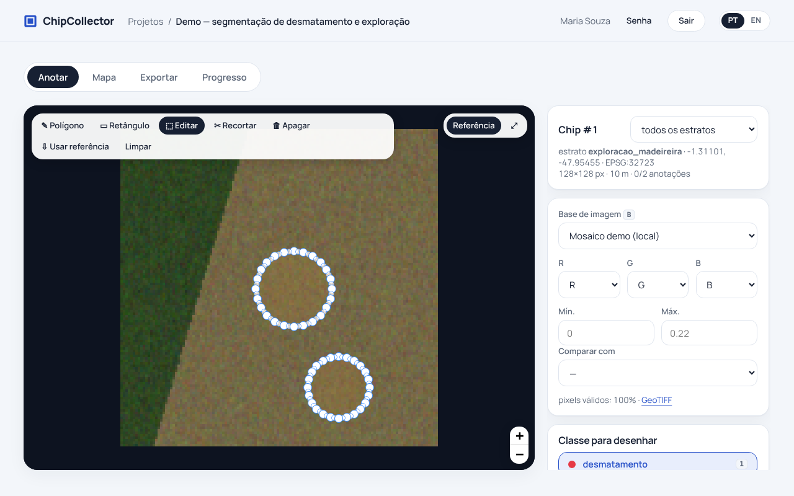
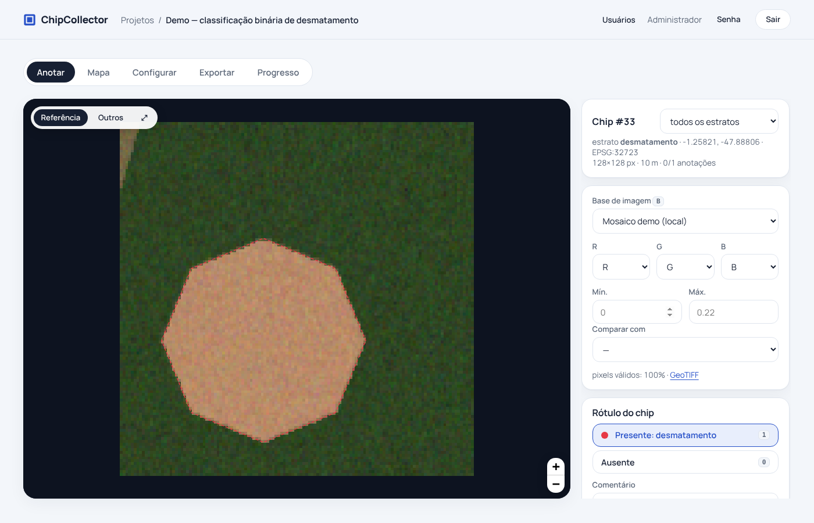

# ChipCollector

Plataforma web, multiusuário e 100% open source (Python) para **coleta de amostras de referência
(chips) destinadas ao treinamento de modelos de IA** em sensoriamento remoto. O alvo de detecção
é flexível (extração madeireira, desmatamento, uso e cobertura da terra…) e as duas abordagens mais
comuns são suportadas: **classificação** (rótulo por chip) e **segmentação** (polígonos por chip).


| Segmentação | Classificação |
|---|---|
|  |  |

> **Passo a passo de cada funcionalidade:** veja o [Guia de uso](docs/GUIA.md) — configurar um projeto, coletar, validar e exportar.

## Funcionalidades × requisitos da proposta

| Requisito | Como foi atendido |
|---|---|
| **1. Acesso multiusuário** | Contas com login (senha PBKDF2, sessão por cookie assinado), papéis *administrador* / *anotador*. Cada anotação grava o autor e data. Fila de chips com **reserva** (lock) para evitar que dois usuários anotem o mesmo chip ao mesmo tempo; opção de *N anotadores por chip* para medir concordância. Painel de progresso por usuário. |
| **2. Ambiente web** | Servidor FastAPI + interface no navegador (Leaflet + Leaflet‑Geoman, empacotados localmente). Roda em servidor ou no próprio computador (`chipcollector serve`), com ou sem Docker. |
| **3. Dados de referência** | Upload de camadas **vetoriais** (GPKG, GeoJSON, Shapefile zipado, KML, FlatGeobuf, GeoParquet) ou **matriciais** categóricas (GeoTIFF, ex.: MapBiomas, PRODES). Cada camada tem um papel: **amostra já estratificada** fora do sistema (pontos e/ou polígonos; o admin indica o campo do estrato e o da classe de referência, e cada feição vira um chip) ou **referência para sortear** (o sistema estratifica pelas classes e sorteia os chips). Uma verificação confere campos, geometrias, amostras sem estrato, duplicadas e sobrepostas antes de gerar. |
| **4a. Tamanho do chip** | Definido por projeto (pixels) + resolução (m/pixel). Grade alinhada em UTM local. |
| **4b. Número de classes** | Classe única (presença/ausência) ou múltiplas classes, com opção de uma ou várias classes por chip. |
| **4c. Diferentes bases de imagem** | Cada projeto tem várias “bases” (sensor + período + nuvens + composição). Sensores: **Sentinel‑2, Landsat 8/9, Landsat 5/7, Sentinel‑1** (Planetary Computer, gratuito), Sentinel‑2 (Earth Search/AWS, gratuito), **Google Earth Engine** (gratuito p/ ONGs: S2, Landsat, S1, **Planet NICFI**, qualquer coleção) e **rasters locais**. Troca de base, composição RGB, contraste e comparação com transparência durante a anotação. |
| **4d. Tipo de anotação** | **Segmentação:** desenhar, editar, recortar e apagar polígonos; botão *Usar referência* copia os polígonos da camada de referência para **refinamento**. **Classificação:** rótulo binário presença/ausência (ou multiclasse) por atalho de teclado. Status *incerto* e *pular*. |
| **5. Exportação** | Pacote .zip com GeoTIFF multibanda por chip/base, máscaras GeoTIFF, **COCO JSON**, `labels.csv`, GeoJSON, divisão treino/val/teste e metadados com autoria. Download local e envio ao **Google Drive** (OAuth por usuário ou conta de serviço). Também por linha de comando. |

## Início rápido (local, sem internet de imagens)

```bash
git clone https://github.com/JailsonS/chipcollector.git
cd chipcollector
python -m venv .venv && source .venv/bin/activate      # Windows: .venv\Scripts\activate
pip install -e ".[all]"

# dados sintéticos + usuário admin/admin123 + 2 projetos de demonstração
chipcollector demo --seed

chipcollector serve          # abra http://localhost:8000
```

**Primeiro acesso:**
- com `chipcollector demo --seed`, entre com usuário `admin` e senha `admin123`;
- sem `--seed`, a tela abre em *Criar conta*: a primeira conta criada vira administradora.

A senha aparece oculta ao digitar; use o botão *Mostrar* no campo para conferir.
Para criar um usuário pelo terminal: `chipcollector create-user nome --password "senha" --admin`.

### Versão de teste online, sem servidor

Para que outras pessoas testem pela internet sem pagar hospedagem, rode a aplicação no seu
computador e publique um endereço temporário com o Cloudflare Quick Tunnel (gratuito, sem conta):

```bash
# 1. instale o cloudflared (uma vez)
brew install cloudflared                          # macOS
winget install --id Cloudflare.cloudflared         # Windows
# Linux: https://developers.cloudflare.com/cloudflare-one/networks/connectors/cloudflare-tunnel/downloads/

# 2. troque a senha de demonstração, se usou --seed
chipcollector set-password admin

# 3. publique
chipcollector share
```

O comando mostra um endereço `https://….trycloudflare.com` para enviar à equipe. Enquanto o túnel
estiver aberto, o cadastro público fica desligado: crie as contas em **Usuários**.

Limites: o endereço muda a cada execução e só funciona com o computador ligado e o comando
rodando; arquivos acima de 100 MB não passam pelo túnel (envie-os pelo endereço local,
`http://localhost:8000`); e o login com Google Drive não funciona nesse endereço temporário.
O passo a passo está no [Guia](docs/GUIA.md#18-publicar-uma-versão-de-teste).

### Docker

```bash
cp .env.example .env         # ajuste se necessário
docker compose up --build    # http://localhost:8000
docker compose exec app chipcollector create-user maria --password "senha123"
```

> Requisitos sem Docker: Python ≥ 3.10. As rodas (wheels) de `rasterio`, `pyogrio` e `pyproj`
> já trazem GDAL/PROJ embutidos — não é preciso instalar GDAL no sistema.

## Fluxo de uso

1. **Criar projeto** (admin): nome, alvo, tipo de anotação, classes, tamanho do chip, resolução,
   anotadores por chip.
2. **Configurar → Bases de imagem**: adicione uma ou mais bases (ex.: *Sentinel‑2 seca 2024*,
   *Landsat 2015*, *NICFI 2023‑06*). Todas são reamostradas para a grade do chip, então uma
   anotação feita sobre um sensor vale para os demais.
3. **Configurar → Camadas de referência e amostras**: envie a camada e diga o papel dela.
   - *Amostra já estratificada* (desenho amostral feito fora do sistema): escolha o campo do estrato
     e, se houver, o da classe de referência. Clique em **Verificar** para conferir o arquivo.
   - *Referência para sortear*: escolha o campo de classe, que define os estratos.
4. **Configurar → Gerar chips**:
   - amostra pronta: cada ponto ou polígono vira um chip; gerar de novo não duplica;
   - referência: escolha quantidade por estrato, chips de *fundo* (negativos, fora das feições),
     espaçamento mínimo e posição.
   Nos dois casos, ligue as classes do arquivo às classes do projeto (pré-rotulagem, que aparece
   como referência tracejada). Chips também podem ser criados com um clique na aba **Mapa**.
5. **Anotar**: cada usuário recebe o próximo chip livre da fila (filtrável por estrato).
6. **Exportar**: escolha bases, status, divisão treino/val/teste e destino.

### Idioma

A interface está em **português e inglês**: use o seletor **PT | EN** no canto superior direito.
A escolha fica salva no navegador; no primeiro acesso, vale o idioma do navegador. As traduções
ficam em `chipcollector/static/i18n.js` (um dicionário por idioma); para incluir outro idioma,
adicione um dicionário e um botão em `LANGS`.

### Atalhos de teclado (aba Anotar)

| Tecla | Ação |
|---|---|
| `1`–`9` | escolher classe (classificação: marca o rótulo; segmentação: classe do próximo polígono) |
| `0` | ausência do alvo |
| `Enter` | salvar e ir para o próximo |
| `U` / `S` | salvar como incerto / pular |
| `B` | alternar base de imagem |
| `R` | mostrar/ocultar referência |
| `P` / `E` / `Del` / `Esc` | polígono / editar / apagar / sair da ferramenta |

## Fontes de imagem

| Provedor | Acesso | Sensores |
|---|---|---|
| Microsoft Planetary Computer | gratuito, sem conta (URLs assinadas automaticamente) | Sentinel‑2 L2A, Landsat 8/9 e 5/7 C2 L2, Sentinel‑1 RTC |
| Element84 Earth Search (AWS Open Data) | gratuito, sem conta | Sentinel‑2 L2A |
| Google Earth Engine | gratuito para ONGs, pesquisa e uso não comercial | Sentinel‑2 SR, Landsat 8/9 e 5/7, Sentinel‑1 GRD, Planet NICFI, coleção personalizada |
| Raster local | upload de GeoTIFF/COG | qualquer (drone, CBERS, NICFI baixado…) |

Nuvens são removidas por pixel (SCL no Sentinel‑2, QA_PIXEL no Landsat) e as cenas do período
são compostas por **mediana** ou pela **cena menos nublada** (lacunas preenchidas pelas seguintes).
As imagens de cada chip são baixadas sob demanda (lendo só a janela necessária dos COGs) e
guardadas em cache em `data/chips/`.

### Configurar o Google Earth Engine

1. Cadastre um projeto Cloud no Earth Engine (uso não comercial é gratuito):
   <https://code.earthengine.google.com/register>.
2. Escolha **uma** forma de autenticar:
   - conta de serviço: crie a chave JSON e defina `CHIPS_GEE_SERVICE_ACCOUNT` e `CHIPS_GEE_KEY_FILE`;
   - ou credencial de usuário: rode `earthengine authenticate` uma vez na máquina do servidor.
3. Defina `CHIPS_GEE_PROJECT=<id-do-projeto>`.
4. Para **Planet NICFI** (trópicos, 4,77 m, mensal), solicite acesso gratuito em
   <https://www.planet.com/nicfi/> com a mesma conta e use a base *GEE → Planet NICFI*
   (coleção padrão `projects/planet-nicfi/assets/basemaps/americas`).

### Configurar o Google Drive

**OAuth por usuário (recomendado)** — cada pessoa envia para o próprio Drive:

1. Google Cloud Console → *APIs e serviços* → ative a **Google Drive API**.
2. Crie credenciais *ID do cliente OAuth* do tipo **Aplicativo da Web**, com URI de redirecionamento
   `{CHIPS_PUBLIC_URL}/api/drive/callback` (ex.: `http://localhost:8000/api/drive/callback`).
3. Baixe o JSON e defina `CHIPS_DRIVE_CLIENT_SECRETS=/caminho/client.json`.
4. Na aba **Exportar**, clique em *Conectar meu Google Drive*. O escopo é `drive.file`: o app só
   enxerga os arquivos que ele mesmo cria (pasta `ChipCollector`).

**Conta de serviço** — para enviar tudo a um **Drive compartilhado** da organização: defina
`CHIPS_DRIVE_SERVICE_ACCOUNT` (JSON) e `CHIPS_DRIVE_FOLDER_ID` (pasta dentro do Drive
compartilhado, com a conta de serviço como membro). Também usado por `chipcollector export --drive`.

## Formato da exportação

```
<projeto>_<data>.zip
└── <projeto>_<data>/
    ├── metadata.json            projeto, classes, bases, contagens por split/anotador/rótulo
    ├── labels.csv               1 linha por anotação (chip, autor, status, rótulos, one-hot, split, caminhos)
    ├── chips.geojson            contornos dos chips (WGS84) com rótulo e autoria
    ├── annotations.geojson      polígonos anotados (WGS84)                      [segmentação]
    ├── images/<base>/chip_000123.tif   float32 multibanda (reflectância / dB), CRS UTM
    ├── masks/chip_000123__<usuario>.tif uint8: 0 = fundo, n = id da classe      [segmentação]
    └── coco/<base>.json         COCO (polígonos em pixels) apontando para images/<base>/  [segmentação]
```

Funciona diretamente com TorchGeo, segmentation‑models‑pytorch, Raster Vision, Detectron2/
MMDetection (COCO), Keras/TensorFlow e qualquer pipeline com rasterio/xarray. Exemplo mínimo:

```python
import pandas as pd, rasterio
df = pd.read_csv("labels.csv")
treino = df[(df.split == "train") & (df.status == "done")]
for _, r in treino.iterrows():
    x = rasterio.open(r["image_s2-2024-seca"]).read()      # (bandas, H, W)
    y = rasterio.open(r["mask_path"]).read(1)              # segmentação
    # ou r["present"] / r["cls_<classe>"] para classificação
```

Linha de comando: `chipcollector export <id_projeto> --out ./exports [--source s2-2024] [--status done uncertain] [--drive]`.

## Configuração (variáveis de ambiente)

Veja [`.env.example`](.env.example). Principais: `CHIPS_DATA_DIR` (dados, cache e SQLite),
`CHIPS_DATABASE_URL` (PostgreSQL para equipes grandes: `pip install -e ".[postgres]"`),
`CHIPS_ALLOW_SIGNUP`, `CHIPS_LOCK_MINUTES`, `CHIPS_PUBLIC_URL`, `CHIPS_GEE_*`, `CHIPS_DRIVE_*`.

Para uso em servidor público, coloque atrás de um proxy HTTPS (Caddy/Nginx), defina
`CHIPS_PUBLIC_URL=https://…`, `CHIPS_SECRET_KEY` e `CHIPS_ALLOW_SIGNUP=false`.

## Arquitetura

```
chipcollector/
├── app.py          API REST (FastAPI) + serve a interface
├── db.py           modelos: User, Project, ReferenceLayer, LocalRaster, Chip, ChipLock, Annotation, ExportJob
├── auth.py         login/sessão, papéis
├── layers.py       leitura e inspeção de camadas vetoriais/matriciais
├── sampling.py     amostragem estratificada, chips de fundo, recorte da referência por chip
├── geo.py          grade do chip em UTM, conversões pixel ↔ mapa
├── imagery/        bases de imagem: stac.py (Planetary Computer/Earth Search), gee.py, local.py
├── export.py       pacote de treinamento (GeoTIFF, máscaras, COCO, CSV, GeoJSON)
├── drive.py        envio ao Google Drive
├── cli.py          serve | create-user | export | demo
└── static/         interface (HTML/CSS/JS + Leaflet/Geoman empacotados)
```

API documentada automaticamente em `http://localhost:8000/docs`.

Bibliotecas: FastAPI, SQLModel/SQLAlchemy, rasterio/GDAL, GeoPandas, Shapely, pyproj,
pystac‑client, planetary‑computer, earthengine‑api, google‑api‑python‑client, Pillow, NumPy,
Leaflet, Leaflet‑Geoman (free) e a fonte Manrope (OFL). Todas open source.

## Testes

```bash
pip install -e ".[dev]"
pytest -q
```

Os testes cobrem o fluxo completo (contas, projeto, upload de vetor/raster, geração de chips,
fila multiusuário com reserva, anotação de segmentação e classificação, exportação e conteúdo das
máscaras/COCO) usando dados sintéticos, sem depender de rede.

## Licença

MIT — © 2026 Jailson Soares de Souza Filho Alves.
