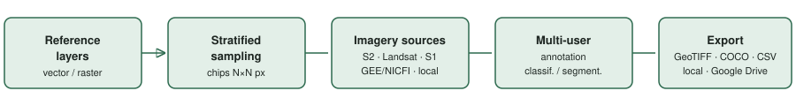

# ChipCollector

A multi-user, 100% open-source (Python) web platform for **collecting reference samples (chips)
for training AI models** in remote sensing. The detection target is flexible (selective logging,
deforestation, land use and land cover…) and both common approaches are supported:
**classification** (one label per chip) and **segmentation** (polygons per chip).



| Segmentation | Classification |
|---|---|
|  |  |

> **Step-by-step for every feature:** see the [User guide](docs/GUIDE.md) — setting up a project, collecting, validating and exporting.

## Features × proposal requirements

| Requirement | How it is met |
|---|---|
| **1. Multi-user access** | Accounts with login (PBKDF2 passwords, signed-cookie sessions), *administrator* / *annotator* roles. Every annotation records its author and date. Chip queue with **reservation** (lock) so two users never annotate the same chip at the same time; optional *N annotators per chip* to measure agreement. Per-user progress dashboard. |
| **2. Web environment** | FastAPI server + browser interface (Leaflet + Leaflet‑Geoman, bundled locally). Runs on a server or on your own computer (`chipcollector serve`), with or without Docker. |
| **3. Reference data** | Upload **vector** layers (GPKG, GeoJSON, zipped Shapefile, KML, FlatGeobuf, GeoParquet) or categorical **raster** layers (GeoTIFF, e.g. MapBiomas, PRODES). Each layer has a role: **pre-stratified sample** made outside the system (points and/or polygons; the admin picks the stratum field and the reference class field, and each feature becomes a chip) or **reference to sample from** (the system stratifies by class and draws the chips). A check validates fields, geometries, samples without a stratum, duplicates and overlaps before generating. |
| **4a. Chip size** | Set per project (pixels) + resolution (m/pixel). Grid aligned to the local UTM zone. |
| **4b. Number of classes** | Single class (presence/absence) or multiple classes, with one or several classes per chip. |
| **4c. Different imagery sources** | Each project has several “imagery sources” (sensor + period + clouds + composite). Sensors: **Sentinel‑2, Landsat 8/9, Landsat 5/7, Sentinel‑1** (Planetary Computer, free), Sentinel‑2 (Earth Search/AWS, free), **Google Earth Engine** (free for NGOs: S2, Landsat, S1, **Planet NICFI**, any collection) and **local rasters**. Switch source, RGB composite, stretch and compare with transparency while annotating. |
| **4d. Annotation type** | **Segmentation:** draw, edit, cut and delete polygons; the *Use reference* button copies the polygons from the reference layer for **refinement**. **Classification:** binary presence/absence (or multiclass) label via keyboard shortcut. *Unsure* and *Skip* statuses. |
| **5. Export** | .zip package with a multiband GeoTIFF per chip/source, GeoTIFF masks, **COCO JSON**, `labels.csv`, GeoJSON, train/val/test split and metadata with authorship. Local download and upload to **Google Drive** (per-user OAuth or service account). Also available from the command line. |

## Quick start (local, no imagery download needed)

```bash
git clone https://github.com/JailsonS/chipcollector.git
cd chipcollector
python -m venv .venv && source .venv/bin/activate      # Windows: .venv\Scripts\activate
pip install -e ".[all]"

# synthetic data + admin/admin123 user + 2 demo projects
chipcollector demo --seed

chipcollector serve          # open http://localhost:8000
```

**First login:**
- with `chipcollector demo --seed`, log in with username `admin` and password `admin123`;
- without `--seed`, the screen opens on *Create account*: the first account created becomes the administrator.

The password is hidden while you type; use the *Show* button in the field to check it.
To create a user from the terminal: `chipcollector create-user name --password "password" --admin`.

### Online test version, no server needed

To let other people test it over the internet without paying for hosting, run the app on your
computer and publish a temporary address with Cloudflare Quick Tunnel (free, no account):

```bash
# 1. install cloudflared (once)
brew install cloudflared                          # macOS
winget install --id Cloudflare.cloudflared         # Windows
# Linux: https://developers.cloudflare.com/cloudflare-one/networks/connectors/cloudflare-tunnel/downloads/

# 2. change the demo password, if you used --seed
chipcollector set-password admin

# 3. publish
chipcollector share
```

The command prints an `https://….trycloudflare.com` address to send to your team. While the
tunnel is open, public sign-up is turned off: create accounts under **Users**.

Limits: the address changes on every run and only works while the computer is on and the command
is running; files over 100 MB do not pass through the tunnel (upload them via the local address,
`http://localhost:8000`); and Google Drive login does not work on the temporary address.
The step-by-step is in the [Guide](docs/GUIDE.md#18-publish-a-test-version).

### Docker

```bash
cp .env.example .env         # adjust if needed
docker compose up --build    # http://localhost:8000
docker compose exec app chipcollector create-user maria --password "password123"
```

> Requirements without Docker: Python ≥ 3.10. The `rasterio`, `pyogrio` and `pyproj` wheels
> already bundle GDAL/PROJ — there is no need to install GDAL on the system.

## Workflow

1. **Create project** (admin): name, target, annotation type, classes, chip size, resolution,
   annotators per chip.
2. **Set up → Imagery**: add one or more imagery sources (e.g. *Sentinel‑2 dry season 2024*,
   *Landsat 2015*, *NICFI 2023‑06*). All of them are resampled to the chip grid, so an annotation
   made on one sensor holds for the others.
3. **Set up → Reference layers and samples**: upload the layer and set its role.
   - *Pre-stratified sample* (sampling design done outside the system): choose the stratum field
     and, if there is one, the reference class field. Click **Check** to validate the file.
   - *Reference to sample from*: choose the class field, which defines the strata.
4. **Set up → Generate chips**:
   - ready-made sample: each point or polygon becomes a chip; generating again does not duplicate;
   - reference: choose the number per stratum, *background* chips (negatives, outside the
     features), minimum spacing and placement.
   In both cases, map the file's classes to the project classes (pre-labelling, shown as a dashed
   reference). Chips can also be created with a single click on the **Map** tab.
5. **Annotate**: each user gets the next free chip in the queue (filterable by stratum).
6. **Export**: choose imagery sources, status, train/val/test split and destination.

### Language

The interface is available in **Portuguese and English**: use the **PT | EN** switch in the top
right corner. The choice is saved in the browser; on first visit, the browser's language is used.
Translations live in `chipcollector/static/i18n.js` (one dictionary per language); to add another
language, add a dictionary and a button in `LANGS`.

### Keyboard shortcuts (Annotate tab)

| Key | Action |
|---|---|
| `1`–`9` | pick a class (classification: sets the label; segmentation: class of the next polygon) |
| `0` | target absent |
| `Enter` | save and go to the next chip |
| `U` / `S` | save as unsure / skip |
| `B` | switch imagery source |
| `R` | show/hide reference |
| `P` / `E` / `Del` / `Esc` | polygon / edit / delete / exit the tool |

## Imagery sources

| Provider | Access | Sensors |
|---|---|---|
| Microsoft Planetary Computer | free, no account (URLs signed automatically) | Sentinel‑2 L2A, Landsat 8/9 and 5/7 C2 L2, Sentinel‑1 RTC |
| Element84 Earth Search (AWS Open Data) | free, no account | Sentinel‑2 L2A |
| Google Earth Engine | free for NGOs, research and non-commercial use | Sentinel‑2 SR, Landsat 8/9 and 5/7, Sentinel‑1 GRD, Planet NICFI, custom collection |
| Local raster | GeoTIFF/COG upload | any (drone, CBERS, downloaded NICFI…) |

Clouds are masked per pixel (SCL for Sentinel‑2, QA_PIXEL for Landsat) and the scenes in the
period are composited by **median** or by **least cloudy scene** (gaps filled by the next ones).
Each chip's imagery is downloaded on demand (reading only the required window of the COGs) and
cached in `data/chips/`.

### Setting up Google Earth Engine

1. Register a Cloud project with Earth Engine (non-commercial use is free):
   <https://code.earthengine.google.com/register>.
2. Choose **one** way to authenticate:
   - service account: create the JSON key and set `CHIPS_GEE_SERVICE_ACCOUNT` and `CHIPS_GEE_KEY_FILE`;
   - or user credentials: run `earthengine authenticate` once on the server machine.
3. Set `CHIPS_GEE_PROJECT=<project-id>`.
4. For **Planet NICFI** (tropics, 4.77 m, monthly), request free access at
   <https://www.planet.com/nicfi/> with the same account and use the *GEE → Planet NICFI* source
   (default collection `projects/planet-nicfi/assets/basemaps/americas`).

### Setting up Google Drive

**Per-user OAuth (recommended)** — each person uploads to their own Drive:

1. Google Cloud Console → *APIs & Services* → enable the **Google Drive API**.
2. Create *OAuth client ID* credentials of type **Web application**, with the redirect URI
   `{CHIPS_PUBLIC_URL}/api/drive/callback` (e.g. `http://localhost:8000/api/drive/callback`).
3. Download the JSON and set `CHIPS_DRIVE_CLIENT_SECRETS=/path/client.json`.
4. On the **Export** tab, click *Connect my Google Drive*. The scope is `drive.file`: the app only
   sees the files it creates itself (`ChipCollector` folder).

**Service account** — to send everything to an organisation **shared Drive**: set
`CHIPS_DRIVE_SERVICE_ACCOUNT` (JSON) and `CHIPS_DRIVE_FOLDER_ID` (a folder inside the shared
Drive, with the service account as a member). Also used by `chipcollector export --drive`.

## Export format

```
<project>_<date>.zip
└── <project>_<date>/
    ├── metadata.json            project, classes, sources, counts per split/annotator/label
    ├── labels.csv               1 row per annotation (chip, author, status, labels, one-hot, split, paths)
    ├── chips.geojson            chip outlines (WGS84) with label and authorship
    ├── annotations.geojson      annotated polygons (WGS84)                      [segmentation]
    ├── images/<source>/chip_000123.tif   multiband float32 (reflectance / dB), UTM CRS
    ├── masks/chip_000123__<user>.tif     uint8: 0 = background, n = class id   [segmentation]
    └── coco/<source>.json       COCO (polygons in pixels) pointing to images/<source>/  [segmentation]
```

Works directly with TorchGeo, segmentation‑models‑pytorch, Raster Vision, Detectron2/
MMDetection (COCO), Keras/TensorFlow and any rasterio/xarray pipeline. Minimal example:

```python
import pandas as pd, rasterio
df = pd.read_csv("labels.csv")
train = df[(df.split == "train") & (df.status == "done")]
for _, r in train.iterrows():
    x = rasterio.open(r["image_s2-2024-seca"]).read()      # (bands, H, W)
    y = rasterio.open(r["mask_path"]).read(1)              # segmentation
    # or r["present"] / r["cls_<class>"] for classification
```

Command line: `chipcollector export <project_id> --out ./exports [--source s2-2024] [--status done uncertain] [--drive]`.

## Configuration (environment variables)

See [`.env.example`](.env.example). Main ones: `CHIPS_DATA_DIR` (data, cache and SQLite),
`CHIPS_DATABASE_URL` (PostgreSQL for large teams: `pip install -e ".[postgres]"`),
`CHIPS_ALLOW_SIGNUP`, `CHIPS_LOCK_MINUTES`, `CHIPS_PUBLIC_URL`, `CHIPS_GEE_*`, `CHIPS_DRIVE_*`.

For use on a public server, put it behind an HTTPS proxy (Caddy/Nginx) and set
`CHIPS_PUBLIC_URL=https://…`, `CHIPS_SECRET_KEY` and `CHIPS_ALLOW_SIGNUP=false`.

## Architecture

```
chipcollector/
├── app.py          REST API (FastAPI) + serves the interface
├── db.py           models: User, Project, ReferenceLayer, LocalRaster, Chip, ChipLock, Annotation, ExportJob
├── auth.py         login/session, roles
├── layers.py       reading and inspecting vector/raster layers
├── sampling.py     stratified sampling, background chips, clipping the reference per chip
├── geo.py          chip grid in UTM, pixel ↔ map conversions
├── imagery/        imagery sources: stac.py (Planetary Computer/Earth Search), gee.py, local.py
├── export.py       training package (GeoTIFF, masks, COCO, CSV, GeoJSON)
├── drive.py        upload to Google Drive
├── cli.py          serve | create-user | export | demo
└── static/         interface (HTML/CSS/JS + bundled Leaflet/Geoman)
```

The API is documented automatically at `http://localhost:8000/docs`.

Libraries: FastAPI, SQLModel/SQLAlchemy, rasterio/GDAL, GeoPandas, Shapely, pyproj,
pystac‑client, planetary‑computer, earthengine‑api, google‑api‑python‑client, Pillow, NumPy,
Leaflet, Leaflet‑Geoman (free) and the Manrope font (OFL). All open source.

## Tests

```bash
pip install -e ".[dev]"
pytest -q
```

The tests cover the full workflow (accounts, project, vector/raster upload, chip generation,
multi-user queue with reservation, segmentation and classification annotation, export and the
contents of the masks/COCO) using synthetic data, with no network dependency.

## License

MIT — © 2026 Jailson Soares de Souza Filho Alves.
