# Guia de uso do ChipCollector

Este guia mostra, passo a passo, como usar cada parte da plataforma. Cada funcionalidade é
apresentada como uma **história**: quem faz, onde fica, o que a pessoa quer conseguir e como fazer.
As telas são da versão atual, com os dados de demonstração (`chipcollector demo --seed`).

Para instalação e detalhes técnicos, veja o [README](../README.md).

---

## Mapa das histórias

| Jornada | Quem | Histórias |
|---|---|---|
| **Primeiros passos** | todos | [1. Entrar pela primeira vez](#1-entrar-pela-primeira-vez) · [2. Trocar idioma e senha](#2-trocar-idioma-e-senha) |
| **Administração** | administrador | [3. Montar a equipe](#3-montar-a-equipe) |
| **Configurando um projeto** | administrador | [4. Criar o projeto](#4-criar-o-projeto) · [5. Escolher as bases de imagem](#5-escolher-as-bases-de-imagem) · [6. Carregar e configurar as camadas](#6-carregar-e-configurar-as-camadas) · [7. Gerar os chips](#7-gerar-os-chips) · [8. Criar um chip com um clique](#8-criar-um-chip-com-um-clique) |
| **Coletando dados** | anotadores | [9. Trabalhar a fila de chips](#9-trabalhar-a-fila-de-chips) · [10. Rotular chips (classificação)](#10-rotular-chips-classificação) · [11. Desenhar o alvo (segmentação)](#11-desenhar-o-alvo-segmentação) · [12. Corrigir uma anotação](#12-corrigir-uma-anotação) |
| **Validando dados** | administrador | [13. Anotação dupla e às cegas](#13-anotação-dupla-e-às-cegas) · [14. Revisar o trabalho de outra pessoa](#14-revisar-o-trabalho-de-outra-pessoa) · [15. Acompanhar o progresso](#15-acompanhar-o-progresso) |
| **Exportando** | todos | [16. Gerar o pacote de treinamento](#16-gerar-o-pacote-de-treinamento) · [17. Enviar ao Google Drive](#17-enviar-ao-google-drive) |
| **Publicar para teste** | quem roda a plataforma | [18. Publicar uma versão de teste](#18-publicar-uma-versão-de-teste) |
| **Quando algo dá errado** | todos | [Problemas comuns](#problemas-comuns) |

### O ciclo completo

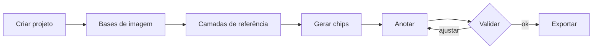

---

## Primeiros passos

### 1. Entrar pela primeira vez

> **Quem:** todos · **Onde:** tela inicial · **Tempo:** 1 minuto
>
> *"Quero entrar na plataforma e começar a trabalhar."*

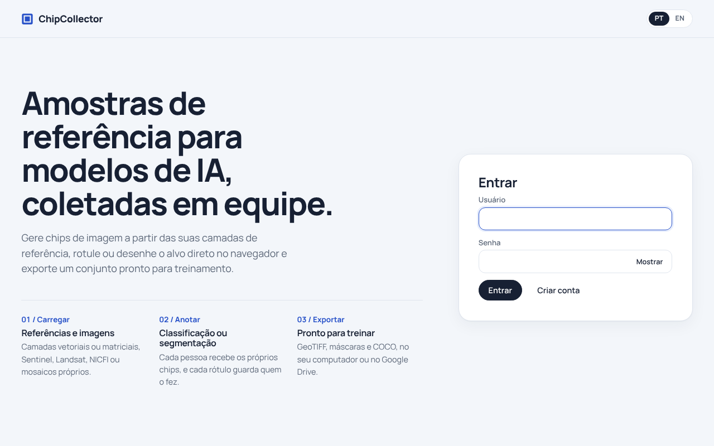

1. Abra o endereço da plataforma (localmente, `http://localhost:8000`).
2. Se você recebeu usuário e senha, preencha os dois campos e aperte **Enter**.
3. Se ainda não tem conta, clique em **Criar conta**, escolha um nome de usuário e uma senha com pelo menos 6 caracteres.

**Resultado:** você chega à lista de projetos.

<details>
<summary>Ver a lista de projetos</summary>

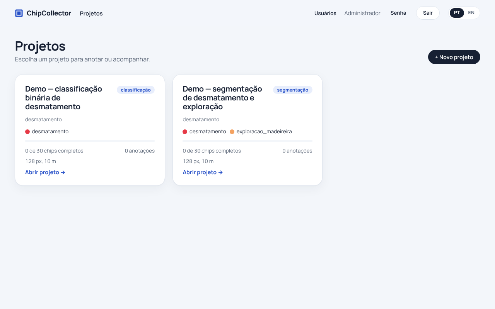

</details>

> [!NOTE]
> A **primeira conta criada** na instalação vira a administradora. Quando ainda não há nenhum
> usuário, a tela já abre em *Criar conta* e avisa isso.

> [!TIP]
> A senha fica oculta enquanto você digita. Use o botão **Mostrar** dentro do campo para conferir.
> Com os dados de demonstração, entre com `admin` / `admin123`.

---

### 2. Trocar idioma e senha

> **Quem:** todos · **Onde:** barra do topo · **Tempo:** 30 segundos
>
> *"Quero usar a plataforma em inglês" ou "quero trocar a senha que recebi."*

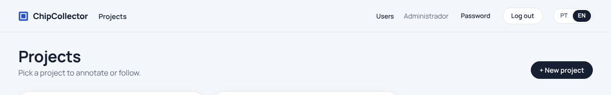

- **Idioma:** clique em **PT** ou **EN** no canto superior direito. A tela muda na hora e a escolha fica guardada no seu navegador.
- **Senha:** clique em **Senha** no topo, digite a nova senha (mínimo 6 caracteres) e confirme.

---

## Administração

### 3. Montar a equipe

> **Quem:** administrador · **Onde:** topo → **Usuários** · **Tempo:** 1 minuto por pessoa
>
> *"Quero dar acesso às pessoas que vão anotar e decidir quem pode configurar projetos."*

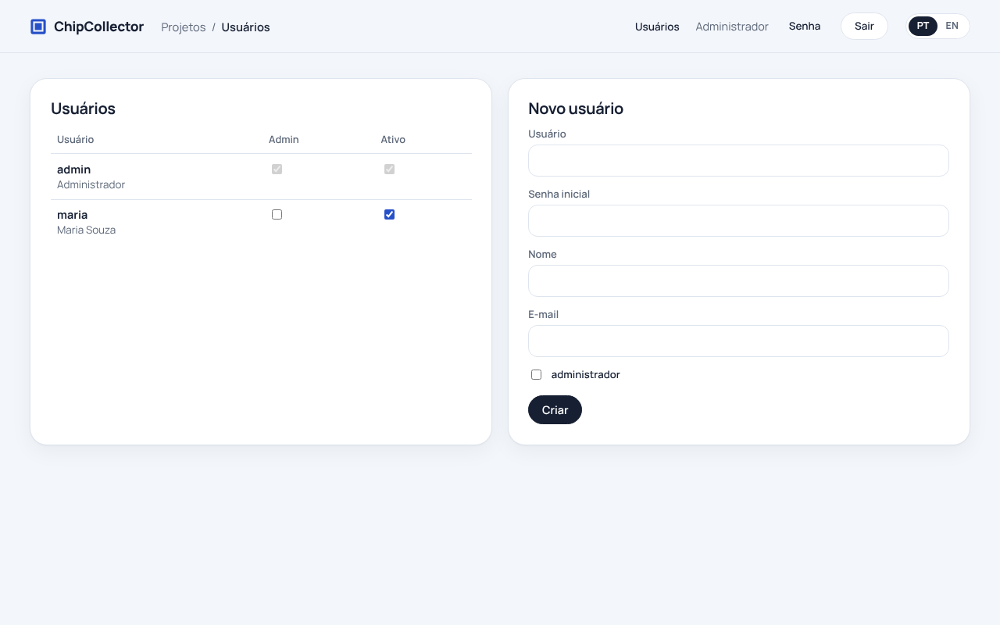

1. Clique em **Usuários** no topo (só aparece para administradores).
2. Em **Novo usuário**, preencha usuário, senha inicial, nome e e-mail.
3. Marque **administrador** só para quem vai criar e configurar projetos.
4. Clique em **Criar** e envie usuário e senha para a pessoa. Peça para ela trocar a senha no primeiro acesso ([história 2](#2-trocar-idioma-e-senha)).

Na lista ao lado você pode, a qualquer momento:
- **Admin:** dar ou tirar o papel de administrador;
- **Ativo:** desmarcar para bloquear o acesso de alguém, sem apagar o que a pessoa já anotou.

| O que cada papel pode fazer | Anotador | Administrador |
|---|:---:|:---:|
| Anotar chips, ver mapa e progresso | sim | sim |
| Criar chip com um clique no mapa | sim | sim |
| Exportar amostras | sim | sim |
| Criar e configurar projetos, enviar camadas, gerar chips | | sim |
| Ver anotações de outras pessoas no mesmo chip | | sim |
| Gerenciar usuários | | sim |

> [!TIP]
> Por padrão, qualquer pessoa pode criar a própria conta na tela inicial. Para que só
> administradores criem contas, inicie o servidor com `CHIPS_ALLOW_SIGNUP=false`.

> [!NOTE]
> Ainda não há botão para o administrador redefinir a senha de outra pessoa. Se alguém esquecer a
> senha, desative a conta antiga e crie uma nova.

---

## Configurando um projeto

### 4. Criar o projeto

> **Quem:** administrador · **Onde:** Projetos → **+ Novo projeto** · **Tempo:** 3 minutos
>
> *"Quero começar a coletar amostras de extração madeireira, com polígonos, em chips de 256 × 256 pixels."*

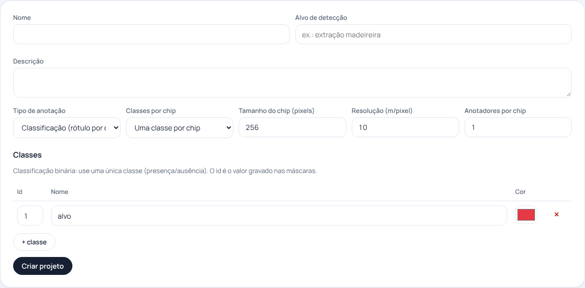

1. Na lista de projetos, clique em **+ Novo projeto**.
2. Preencha:

   | Campo | O que decidir |
   |---|---|
   | **Nome** e **Alvo de detecção** | Ex.: "Extração madeireira 2024", alvo "extração madeireira" |
   | **Tipo de anotação** | *Classificação*: um rótulo por chip (presente/ausente ou qual classe). *Segmentação*: polígonos desenhados dentro do chip |
   | **Classes por chip** | *Uma classe*: cada chip recebe no máximo uma classe. *Múltiplas*: um chip pode ter várias |
   | **Tamanho do chip** e **Resolução** | Ex.: 256 px × 10 m = 2,56 km de lado. Use a resolução da imagem que será usada no treino |
   | **Anotadores por chip** | 1 para coletar rápido; 2 ou mais para medir concordância ([história 13](#13-anotação-dupla-e-às-cegas)) |
   | **Classes** | Nome e cor de cada classe. O **id** é o valor gravado nas máscaras (0 é sempre o fundo) |

3. Clique em **Criar projeto**. Você vai direto para a aba **Configurar**.

> [!IMPORTANT]
> **Tamanho do chip** e **resolução** não podem mudar depois que os chips forem gerados. Decida
> antes de gerar.

> [!TIP]
> Para **classificação binária** (tem ou não tem o alvo), crie uma única classe. O anotador vai ver
> os botões *Presente* e *Ausente*.

<details>
<summary>Ver a tela completa de parâmetros (aba Configurar → 01)</summary>

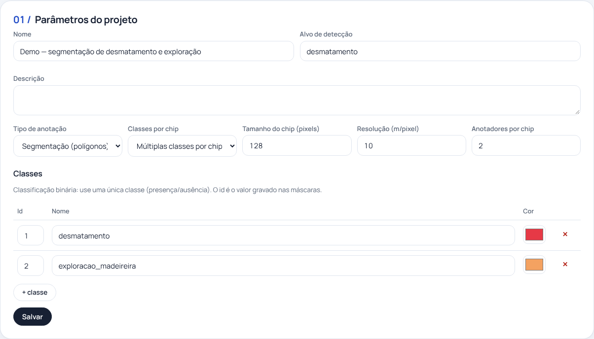

</details>

---

### 5. Escolher as bases de imagem

> **Quem:** administrador · **Onde:** Configurar → **02 / Bases de imagem** · **Tempo:** 5 minutos
>
> *"Quero que os anotadores vejam o alvo na época certa: Sentinel-2 na seca e Planet NICFI para mais detalhe."*

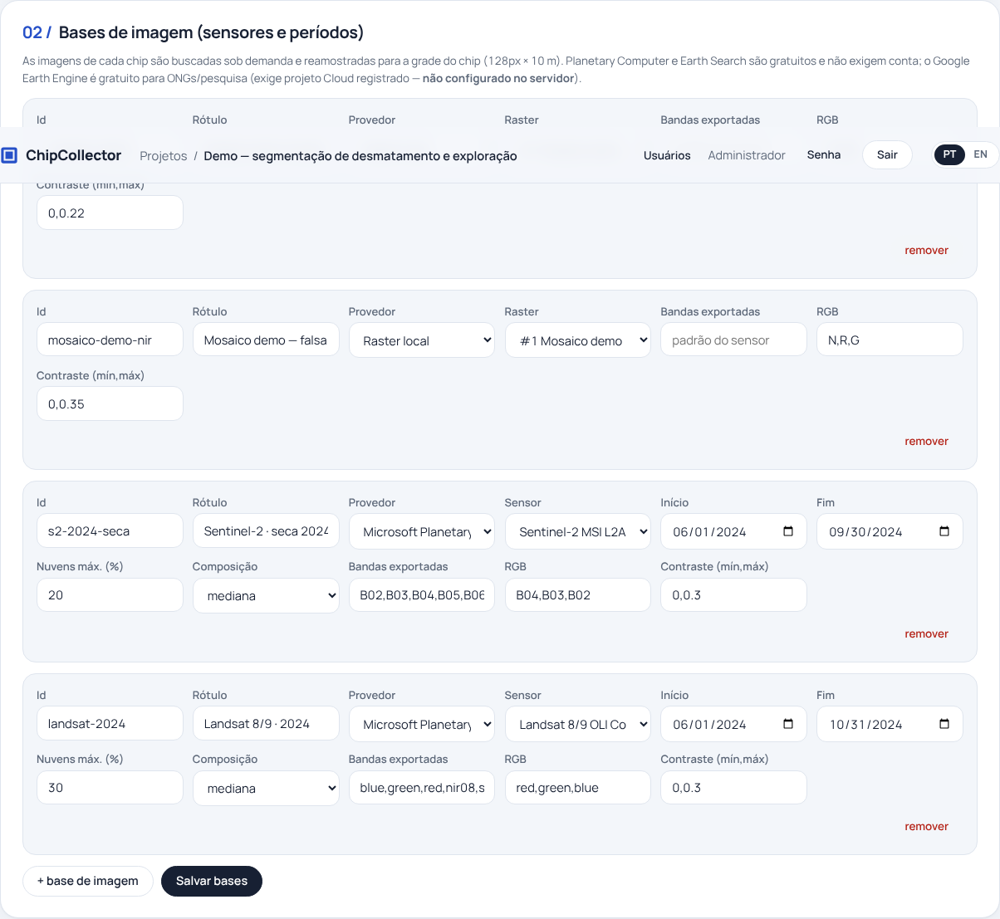

1. Clique em **+ base de imagem**. Cada base é uma combinação de **provedor + sensor + período**.
2. Preencha:
   - **Id** e **Rótulo:** como a base aparece para os anotadores (ex.: `s2-2024-seca`, "Sentinel-2 · seca 2024");
   - **Provedor** e **Sensor:** veja a tabela abaixo;
   - **Início** e **Fim:** o período das cenas;
   - **Nuvens máx.:** descarta cenas mais nubladas que isso;
   - **Composição:** *mediana* (mistura todas as cenas, remove nuvens melhor) ou *cena menos nublada* (uma data só, mais nítida);
   - **RGB** e **Contraste:** como a imagem aparece na tela (pode deixar em branco para usar o padrão).
3. Repita para quantas bases quiser e clique em **Salvar bases**.

| Provedor | Sensores | Precisa de conta? |
|---|---|---|
| Microsoft Planetary Computer | Sentinel-2, Landsat 8/9, Landsat 5/7, Sentinel-1 | Não |
| Earth Search (AWS) | Sentinel-2 | Não |
| Google Earth Engine | Sentinel-2, Landsat, Sentinel-1, **Planet NICFI**, qualquer coleção | Sim, gratuita para ONGs e pesquisa (configurada no servidor) |
| Raster local | Qualquer GeoTIFF que você enviar | Não |

> [!TIP]
> Crie **duas bases do mesmo alvo em épocas diferentes** (ex.: seca e chuva, ou antes e depois).
> Na anotação, o anotador alterna entre elas com a tecla **B** ou sobrepõe uma à outra com
> *Comparar com*.

> [!NOTE]
> Para usar um mosaico seu (drone, CBERS, NICFI baixado), envie primeiro o arquivo em
> **Rasters locais** ([história 6](#6-carregar-e-configurar-as-camadas)) e depois crie uma base com
> provedor **Raster local**.

---

### 6. Carregar e configurar as camadas

> **Quem:** administrador · **Onde:** Configurar → **03 / Camadas de referência e amostras** · **Tempo:** 3 minutos
>
> *"A equipe de estatística já fez o desenho amostral e me mandou os pontos e polígonos com o estrato
> de cada amostra. Quero que cada um vire um chip."* ou *"Tenho os polígonos do PRODES e quero que o
> sistema sorteie os chips."*

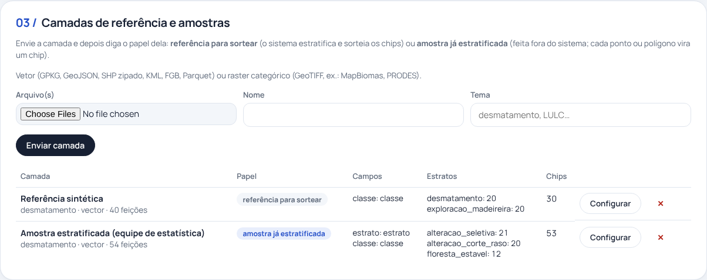

Toda camada tem um **papel**, e é você quem diz qual é:

| Papel | Quando usar | O que o sistema faz |
|---|---|---|
| **Amostra já estratificada** | O desenho amostral foi feito fora do sistema | Cada ponto ou polígono vira **um chip**, centrado nele. Nada é sorteado |
| **Referência para sortear** | Você tem feições de referência e quer que o sistema escolha as amostras | Estratifica pelas classes e **sorteia** chips dentro das feições ([história 7](#7-gerar-os-chips)) |

**Enviar**

1. Em **Arquivo(s)**, escolha o arquivo:
   - **vetor:** GeoPackage, GeoJSON, KML, FlatGeobuf, GeoParquet ou Shapefile (o `.zip` ou os arquivos `.shp`, `.dbf`, `.shx`, `.prj` juntos);
   - **raster categórico:** GeoTIFF com um número inteiro por classe (ex.: MapBiomas). Raster é sempre *referência para sortear*.
2. Dê um **Nome** e um **Tema** e clique em **Enviar camada**.

**Configurar** (abre sozinho depois do envio, ou pelo botão **Configurar** na linha da camada)

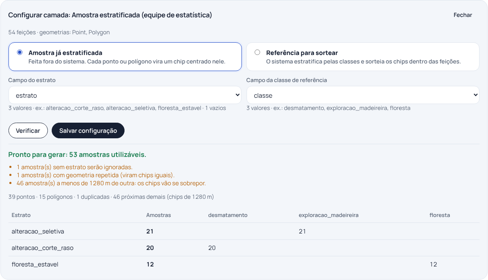

3. Escolha o **papel**. O sistema dá uma sugestão quando o arquivo tem um campo parecido com
   "estrato" ou só tem pontos, mas a decisão é sua.
4. Escolha os **campos** nas listas. Abaixo de cada uma aparecem exemplos de valores, para conferir:
   - *Amostra já estratificada:* **Campo do estrato** (obrigatório, o estrato do desenho amostral) e **Campo da classe de referência** (opcional, a classe que a equipe atribuiu a cada amostra);
   - *Referência para sortear:* **Campo de classe**, que define os estratos do sorteio.
5. Clique em **Verificar** e leia o relatório. Depois clique em **Salvar configuração**.

O que a verificação confere:

| Resultado | O que significa | O que fazer |
|---|---|---|
| Erro: campo não existe | O campo escolhido não está no arquivo | Escolha outro campo |
| Erro: feições que não são pontos nem polígonos | O arquivo tem linhas ou outras geometrias | Remova-as do arquivo e envie de novo |
| Aviso: amostras sem estrato | Linhas com o campo do estrato vazio | Serão ignoradas. Corrija no arquivo, se não era a intenção |
| Aviso: parece um identificador | O campo tem quase um valor diferente por amostra | Provavelmente você escolheu o `id`; escolha o campo do estrato |
| Aviso: geometria repetida | Duas amostras no mesmo lugar | Viram dois chips iguais. Confira com quem fez a amostra |
| Aviso: próximas demais | Amostras mais perto uma da outra do que o tamanho do chip | Os chips vão se sobrepor. Comum em amostras densas; decida se é aceitável |
| Aviso: polígonos maiores que o chip | O polígono não cabe no chip | O chip fica centrado no polígono e mostra só uma parte dele |

A tabela do relatório mostra quantas amostras há em cada estrato e, se houver campo de classe, o
cruzamento **estrato × classe de referência**. Confira se bate com o desenho amostral.

> [!NOTE]
> Erros impedem salvar. Avisos não impedem: o sistema mostra, e você decide.

> [!TIP]
> Se o estrato e a classe forem a mesma coisa no seu arquivo, escolha o mesmo campo nos dois.

No quadro **Rasters locais**, logo abaixo, você envia mosaicos próprios para usar como base de imagem.

---

### 7. Gerar os chips

> **Quem:** administrador · **Onde:** Configurar → **04 / Gerar chips** · **Tempo:** 1 minuto
>
> *"Quero transformar a amostra em chips para a equipe começar a anotar."*

Escolha a **Camada**. A tela muda conforme o papel dela.

**Se a camada é uma amostra já estratificada**

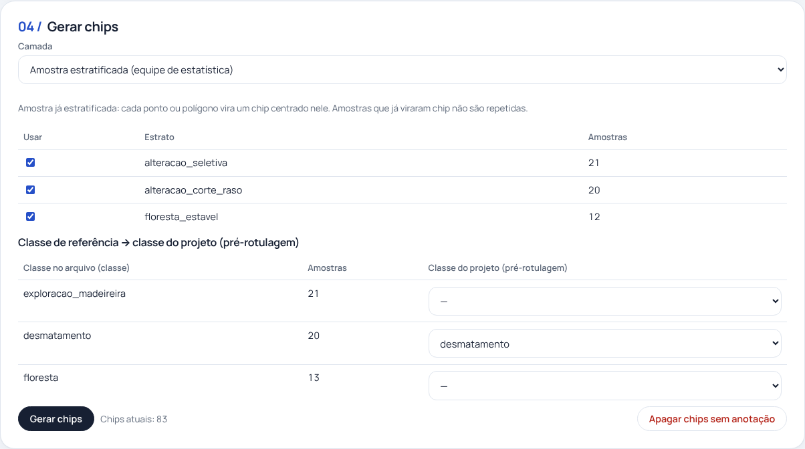

1. Marque os estratos que entram (por padrão, todos).
2. Se a camada tem classe de referência, ligue cada classe do arquivo a uma classe do projeto em
   **Classe do projeto (pré-rotulagem)**. Classes sem correspondência ficam em branco.
3. Clique em **Gerar chips**. Cada amostra vira um chip.

Pode clicar em **Gerar chips** de novo sem medo: amostras que já viraram chip **não são repetidas**.
Isso permite gerar um estrato agora e outro depois.

**Se a camada é referência para sortear**

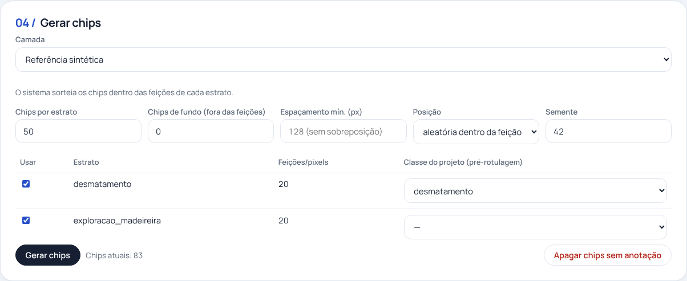

1. Defina:

   | Campo | Para que serve |
   |---|---|
   | **Chips por estrato** | Quantos chips sortear dentro de cada classe da camada |
   | **Chips de fundo** | Chips **fora** de todas as feições: exemplos negativos para o modelo |
   | **Espaçamento mín.** | Distância mínima entre centros, em pixels. Vazio = tamanho do chip (sem sobreposição) |
   | **Posição** | *Aleatória dentro da feição* (variedade) ou *centro da feição* (um chip por feição) |
   | **Semente** | O mesmo número gera o mesmo sorteio |

2. Na tabela de estratos, marque quais usar e ligue cada estrato a uma classe do projeto.
3. Clique em **Gerar chips**. Gerar de novo **acrescenta** um novo sorteio.

**Resultado, nos dois casos:** os chips entram na fila de anotação, misturados entre os estratos.

> [!TIP]
> A **pré-rotulagem** faz a referência aparecer tracejada, na cor da classe, na tela de anotação.
> Em projetos de segmentação, o anotador pode copiar esses polígonos e só ajustar os vértices
> ([história 11](#11-desenhar-o-alvo-segmentação)).

> [!NOTE]
> Para recomeçar, use **Apagar chips sem anotação**. Chips já anotados nunca são apagados por esse
> botão. Numa amostra pronta, as amostras apagadas voltam a poder virar chip.

---

### 8. Criar um chip com um clique

> **Quem:** todos · **Onde:** aba **Mapa** · **Tempo:** segundos
>
> *"Vi uma área de extração que o sorteio não pegou e quero incluí-la como amostra."*

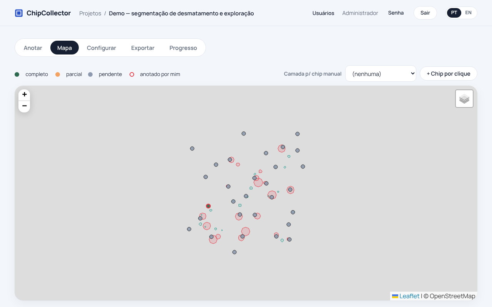

1. Abra a aba **Mapa**. Cada ponto é um chip: verde = completo, laranja = parcial, cinza = pendente, contorno vermelho = anotado por você.
2. (Opcional) Em **Camada p/ chip manual**, escolha uma camada para trazer a referência para o novo chip.
3. Clique em **+ Chip por clique** e depois no ponto exato do mapa.

**Resultado:** o chip é criado com estrato `__manual__` e abre direto na tela de anotação.

> [!TIP]
> Clicar em qualquer ponto do mapa abre aquele chip, útil para revisar uma região específica.
> Use o botão de camadas, no canto do mapa, para trocar o fundo para o mosaico Sentinel-2 sem nuvens.

---

## Coletando dados

### 9. Trabalhar a fila de chips

> **Quem:** anotador · **Onde:** aba **Anotar** · **Tempo:** ao longo do trabalho
>
> *"Quero receber um chip de cada vez, sem esbarrar no trabalho dos colegas."*

Ao abrir **Anotar**, a plataforma entrega o próximo chip livre para você. Ele fica **reservado**
para você por 20 minutos, para que outra pessoa não pegue o mesmo chip ao mesmo tempo.

No painel da direita:
- **Filtro de estrato** (ao lado de "Chip #"): trabalhe só uma classe por vez, se preferir;
- **Base de imagem:** troque o sensor ou período (tecla **B**);
- **R, G, B, Mín., Máx.:** monte a composição de bandas e o contraste. Ex.: NIR no vermelho realça vegetação;
- **Comparar com:** sobrepõe outra base, com uma régua de transparência;
- **GeoTIFF:** baixa a imagem do chip com todas as bandas;
- **Minimapa:** mostra onde o chip fica no mundo;
- **Minhas últimas:** lista o que você anotou recentemente.

Toda anotação termina com um destes três botões:

| Botão | Tecla | Quando usar |
|---|:---:|---|
| **Salvar** | `Enter` | Você tem certeza do rótulo |
| **Incerto** | `U` | Você rotulou, mas tem dúvida; o revisor pode filtrar esses depois |
| **Pular** | `S` | Não dá para interpretar (nuvem, imagem ruim). Não entra na exportação |

> [!NOTE]
> **Pular** conta como a sua vez naquele chip: ele não volta para você. Se o projeto tem um
> anotador por chip, o chip pulado sai da fila de todos.

---

### 10. Rotular chips (classificação)

> **Quem:** anotador · **Onde:** Anotar, em projeto de classificação · **Tempo:** poucos segundos por chip
>
> *"Quero dizer, chip a chip, se há desmatamento ou não, o mais rápido possível."*

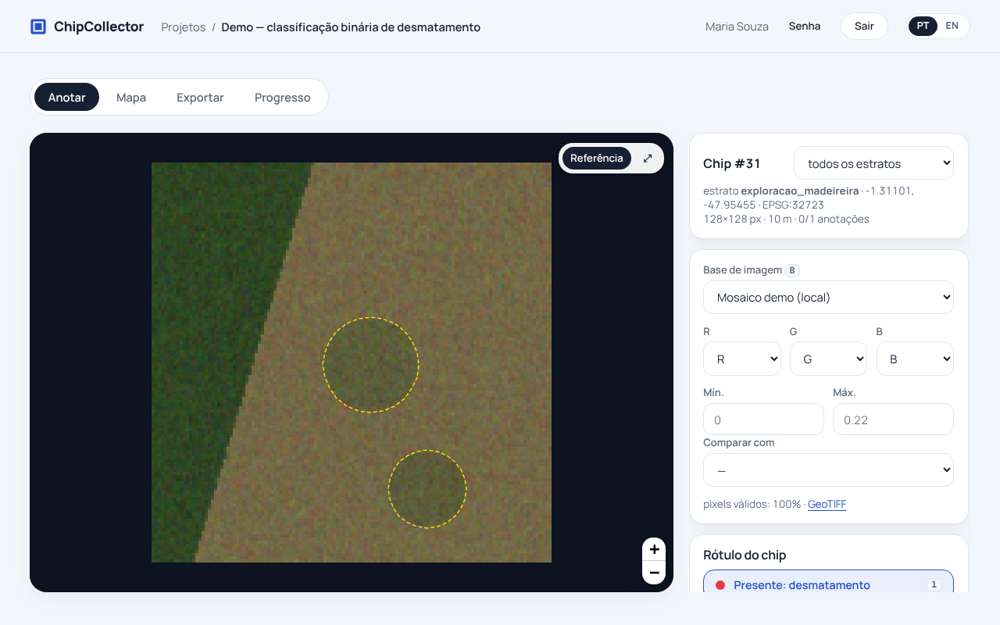

<details>
<summary>Ver um chip vindo de amostra já estratificada</summary>

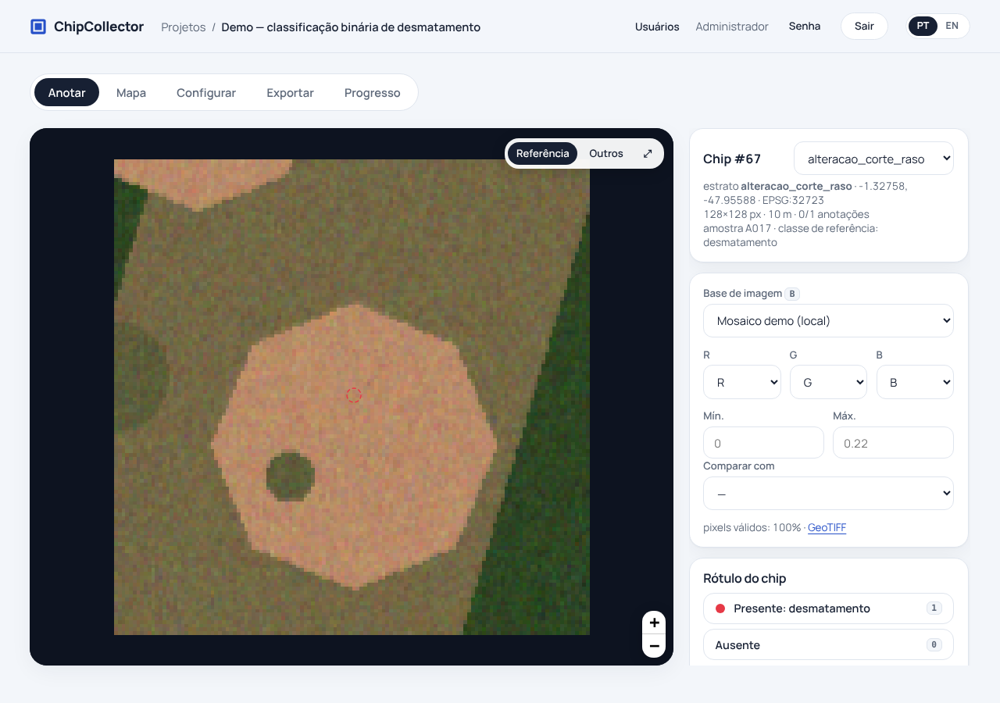

</details>

1. Olhe a imagem. A referência aparece tracejada (tecla **R** mostra ou esconde).
   Em chips que vieram de uma amostra pronta, o painel mostra o identificador da amostra e a
   classe de referência dela, e o ponto da amostra aparece como um anel no centro do chip.
2. Escolha o rótulo:
   - classe única: **1** = Presente, **0** = Ausente;
   - várias classes: **1**, **2**, **3**… para cada classe; **0** = nenhuma. Se o projeto aceita várias classes por chip, cada tecla liga ou desliga aquela classe.
3. Aperte **Enter**. O próximo chip abre sozinho.

> [!TIP]
> Com a mão esquerda no teclado (números, **Enter**, **U**, **S**, **B**), dá para rotular centenas de
> chips por hora sem tocar no mouse.

---

### 11. Desenhar o alvo (segmentação)

> **Quem:** anotador · **Onde:** Anotar, em projeto de segmentação · **Tempo:** 1 a 3 minutos por chip
>
> *"Quero contornar exatamente as clareiras de exploração dentro de cada chip."*

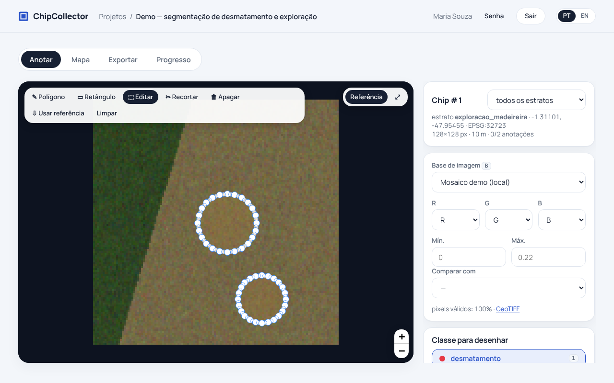

1. Escolha a **classe** no painel (ou tecla **1**, **2**…).
2. Desenhe:
   - **Polígono** (tecla **P**): clique em cada vértice e clique no primeiro ponto para fechar;
   - **Retângulo:** clique num canto e depois no canto oposto;
   - para acelerar, use **Usar referência**, que copia os polígonos da camada de referência já com a classe. Depois só ajuste.
3. Ajuste:
   - **Editar** (tecla **E**): arraste os vértices;
   - **Recortar:** desenhe sobre um polígono para tirar um pedaço (ex.: uma ilha de floresta);
   - **Apagar** (tecla **Del**): depois clique no polígono que quer remover;
   - clique num polígono para trocá-lo para a classe selecionada.
4. Aperte **Esc** para sair da ferramenta e **Enter** para salvar.

> [!NOTE]
> **Sem nenhum polígono = ausência do alvo.** Salvar um chip vazio é uma resposta válida e
> importante para o modelo aprender o que não é o alvo.

> [!TIP]
> Tudo que passar da borda do chip é cortado automaticamente ao salvar. Não precisa ter cuidado com
> a borda.

---

### 12. Corrigir uma anotação

> **Quem:** anotador · **Onde:** Anotar → **Minhas últimas** · **Tempo:** segundos
>
> *"Salvei um chip errado e quero consertar."*

1. Em **Minhas últimas**, clique no número do chip (ex.: `#12`).
2. O chip abre com a sua anotação, marcada como *já anotado por você*.
3. Corrija e salve de novo. A anotação anterior é **substituída**; não cria uma segunda.

---

## Validando dados

### 13. Anotação dupla e às cegas

> **Quem:** administrador · **Onde:** Configurar → **Anotadores por chip** · **Tempo:** 1 minuto
>
> *"Quero saber se os rótulos são confiáveis antes de treinar o modelo."*

1. Em **Configurar → 01 / Parâmetros**, coloque **Anotadores por chip = 2** (ou mais) e salve.
2. A fila passa a priorizar chips que **alguém já começou**, para fechar os pares rapidamente.
3. Cada anotador trabalha **às cegas**: ele não vê o que o colega marcou no mesmo chip.
4. Um chip fica **completo** quando atinge o número de anotações definido.

**Resultado:** na exportação, cada chip tem uma linha (e uma máscara) por anotador. Com isso você
calcula a concordância entre eles (kappa, IoU) e decide o que fazer com os chips em que discordam.

> [!TIP]
> Uma estratégia comum: dupla anotação em 10 a 20% dos chips para medir a qualidade da equipe, e
> anotação simples no restante.

---

### 14. Revisar o trabalho de outra pessoa

> **Quem:** administrador · **Onde:** Anotar → botão **Outros** · **Tempo:** segundos por chip
>
> *"Quero ver como a Maria contornou esta clareira e comparar com o meu entendimento."*

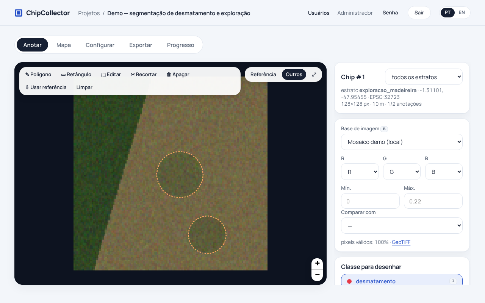

1. Abra o chip: pelo **Mapa** (clique no ponto), pela fila ou pelo endereço `#/p/<projeto>/annotate/<chip>`.
2. Clique em **Outros**. As anotações das outras pessoas aparecem pontilhadas, na cor de cada classe.
3. Esconda a **Referência** se ela atrapalhar a comparação.
4. Se concordar, faça a sua própria anotação e salve. Ela conta como a segunda opinião daquele chip.

O que ajuda a validar:
- em chips de **amostra já estratificada**, a exportação traz a **classe de referência** (`ref_class`) ao lado do rótulo de cada anotador. Isso permite medir a concordância entre a equipe de anotação e a referência;
- o status **Incerto** marca os chips em que o próprio anotador teve dúvida;
- a exportação traz o autor de cada anotação, para revisar por pessoa;
- o **Comentário** de cada anotação aparece no `labels.csv`.

> [!NOTE]
> Ainda não há um botão de *aprovar* ou *rejeitar* a anotação de outra pessoa. Hoje a validação é
> feita pela anotação dupla, pela revisão visual com **Outros** e pelos filtros de status na
> exportação.

---

### 15. Acompanhar o progresso

> **Quem:** todos · **Onde:** aba **Progresso** · **Tempo:** uma olhada
>
> *"Quero saber quanto falta e quem está anotando o quê."*

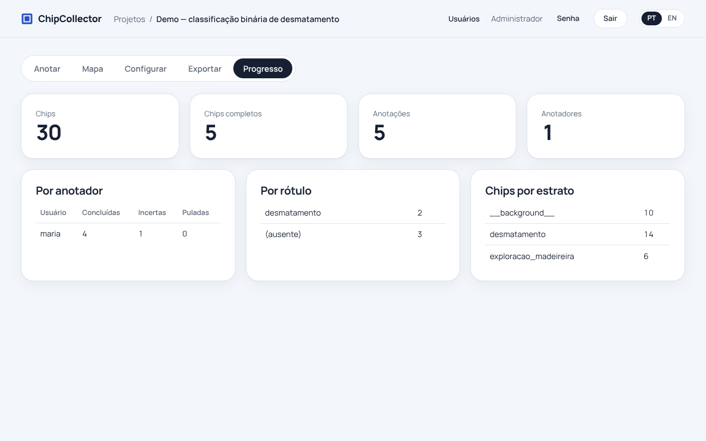

- **Chips, Chips completos, Anotações, Anotadores:** o tamanho do trabalho e quanto já foi feito;
- **Por anotador:** concluídas, incertas e puladas de cada pessoa. Muitas puladas podem indicar uma base de imagem ruim para o alvo;
- **Por rótulo:** se as classes estão equilibradas;
- **Chips por estrato:** quantos chips cada classe da referência gerou.

> [!TIP]
> Se uma classe ficar com poucos exemplos, volte à [história 7](#7-gerar-os-chips) e gere mais
> chips só daquele estrato.

---

## Exportando

### 16. Gerar o pacote de treinamento

> **Quem:** todos · **Onde:** aba **Exportar** · **Tempo:** de segundos a minutos, conforme o volume
>
> *"Quero baixar as amostras prontas para treinar um modelo em PyTorch."*

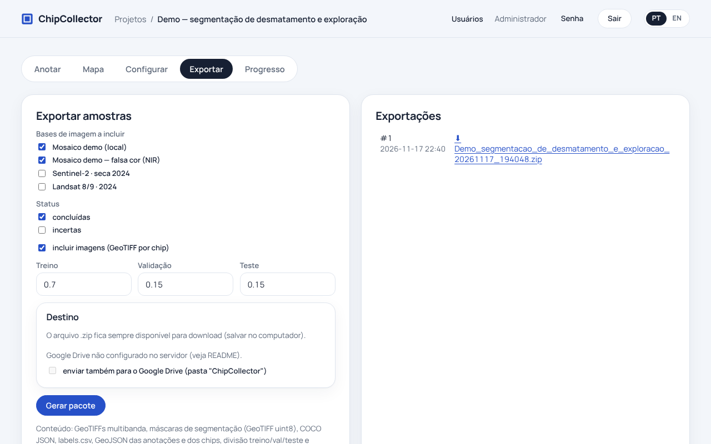

1. Marque as **bases de imagem** que vão no pacote. Cada uma vira uma pasta de GeoTIFFs.
2. Em **Status**, escolha *concluídas* e, se quiser, *incertas*. Chips pulados nunca entram.
3. Ajuste a divisão **Treino / Validação / Teste** (padrão 70 / 15 / 15). A divisão é feita **por chip**: as anotações de um mesmo chip sempre caem no mesmo grupo.
4. Clique em **Gerar pacote**. O progresso aparece em **Exportações**; quando terminar, clique no nome do arquivo para baixar o `.zip`.

O que vem no pacote:

| Arquivo | Para que serve |
|---|---|
| `images/<base>/chip_000123.tif` | Imagem multibanda de cada chip, georreferenciada |
| `masks/chip_000123__<usuario>.tif` | Máscara de segmentação (0 = fundo, n = id da classe) |
| `coco/<base>.json` | Anotações no formato COCO (Detectron2, MMDetection) |
| `labels.csv` | Uma linha por anotação: chip, autor, status, rótulos, divisão, caminhos dos arquivos. Para amostras prontas, também `stratum`, `sample_index` (posição da feição no arquivo enviado) e `ref_class` |
| `annotations.geojson`, `chips.geojson` | Polígonos e contornos dos chips, para abrir no QGIS |
| `metadata.json` | Configuração do projeto, classes, bases e contagens |

> [!TIP]
> Também dá para exportar pelo terminal, útil em rotinas automáticas:
> `chipcollector export 1 --out ./exports --status done uncertain`

---

### 17. Enviar ao Google Drive

> **Quem:** todos · **Onde:** Exportar → **Destino** · **Tempo:** 1 minuto na primeira vez
>
> *"Quero que o pacote vá direto para a pasta da equipe no Drive."*

1. Em **Destino**, clique em **Conectar meu Google Drive** e autorize o acesso.
2. Marque **enviar também para o Google Drive** e gere o pacote.
3. Quando terminar, o link **abrir no Drive** aparece ao lado do arquivo, na pasta `ChipCollector`.

> [!NOTE]
> O botão só aparece se o servidor estiver configurado para o Drive (veja *Configurar o Google
> Drive* no [README](../README.md#configurar-o-google-drive)). A plataforma só enxerga os arquivos
> que ela mesma cria no seu Drive.

---

## Publicar para teste

### 18. Publicar uma versão de teste

> **Quem:** quem roda a plataforma · **Onde:** terminal do seu computador · **Tempo:** 5 minutos na primeira vez
>
> *"Quero que a equipe teste pela internet, sem pagar servidor nem hospedagem."*

A plataforma roda no seu computador e o Cloudflare cria um endereço HTTPS público que aponta
para ela. Não precisa de conta, domínio nem cartão.

1. Instale o `cloudflared` uma vez:

   | Sistema | Comando |
   |---|---|
   | macOS | `brew install cloudflared` |
   | Windows | `winget install --id Cloudflare.cloudflared` |
   | Linux | pacote em developers.cloudflare.com (*Cloudflare Tunnel → Downloads*) |

2. Se você usou os dados de demonstração, troque a senha do `admin`:
   ```bash
   chipcollector set-password admin
   ```
   O comando de publicar se recusa a abrir o túnel enquanto houver conta com a senha `admin123`.

3. Publique:
   ```bash
   chipcollector share
   ```
   Em alguns segundos aparece um quadro com o **endereço público** (`https://….trycloudflare.com`).

4. Crie as contas da equipe em **Usuários** ([história 3](#3-montar-a-equipe)) e envie o endereço
   junto com usuário e senha de cada pessoa.

5. Para encerrar, aperte **Ctrl+C** no terminal. O endereço deixa de funcionar na hora.

> [!IMPORTANT]
> O endereço é **diferente a cada vez** que você roda `chipcollector share`, e só funciona enquanto
> o computador estiver ligado, acordado e com o comando aberto. Para um endereço fixo, é preciso uma
> conta Cloudflare com túnel nomeado ou um servidor próprio.

> [!NOTE]
> Enquanto o túnel está aberto, o **cadastro público fica desligado**: só o administrador cria
> contas. Para liberar, rode `CHIPS_ALLOW_SIGNUP=true chipcollector share`.

> [!TIP]
> Arquivos acima de **100 MB** (mosaicos grandes) não passam pelo túnel. Como a plataforma roda
> no seu computador, envie esses arquivos pelo endereço local, `http://localhost:8000`. Eles
> ficam disponíveis para todos na hora.

O que não funciona pelo endereço temporário:
- **conectar o Google Drive:** o Google exige um endereço de retorno fixo, cadastrado com antecedência. O download do `.zip` funciona normalmente;
- **muitos acessos simultâneos:** o túnel gratuito aceita até 200 requisições ao mesmo tempo, o que basta para uma equipe de teste.

## Problemas comuns

<details>
<summary><b>Não consigo digitar no login</b></summary>

Era um defeito das primeiras versões. Atualize (`git pull`), reinicie o servidor e recarregue a
página com **Ctrl+Shift+R** (no Mac, **Cmd+Shift+R**).
</details>

<details>
<summary><b>A imagem do chip não carrega ou aparece "Nenhuma cena encontrada"</b></summary>

- Amplie o período da base ou aumente o limite de nuvens (**Configurar → 02**).
- Planetary Computer e Earth Search precisam de internet no **servidor**, não só no seu navegador.
- Para o Google Earth Engine, o servidor precisa estar autenticado (veja o README).
- A primeira leitura de cada chip pode levar alguns segundos. Depois a imagem fica guardada.
</details>

<details>
<summary><b>Quero mudar o tamanho do chip depois de gerar</b></summary>

Não é possível no mesmo projeto, porque as anotações existentes ficariam desalinhadas. Crie um
projeto novo com o tamanho certo.
</details>

<details>
<summary><b>O chip que eu queria sumiu da fila</b></summary>

Pode estar reservado para outra pessoa (por até 20 minutos), já ter o número de anotações
necessário, ou ter sido pulado por você. Para abrir um chip específico, clique nele na aba **Mapa**.
</details>

<details>
<summary><b>Apareceu "Erro interno (…). Veja o log do servidor."</b></summary>

Copie a mensagem e as últimas linhas do terminal onde o `chipcollector serve` está rodando e
registre um problema no repositório.
</details>

<details>
<summary><b>Como faço backup?</b></summary>

Copie a pasta de dados inteira (`data/` por padrão) com o servidor parado. Ela guarda o banco, as
camadas, os rasters e as exportações.
</details>
