# ChipCollector user guide

This guide shows, step by step, how to use each part of the platform. Each feature is presented
as a **story**: who does it, where it lives, what the person wants to achieve and how to do it.
The screenshots come from the current version with the demo data (`chipcollector demo --seed`)
and show the interface in Portuguese; switch to **EN** in the top bar to see the labels used in
this guide.

For installation and technical details, see the [README](../README.md).

---

## Story map

| Journey | Who | Stories |
|---|---|---|
| **Getting started** | everyone | [1. Log in for the first time](#1-log-in-for-the-first-time) · [2. Change language and password](#2-change-language-and-password) |
| **Administration** | administrator | [3. Build the team](#3-build-the-team) |
| **Setting up a project** | administrator | [4. Create the project](#4-create-the-project) · [5. Choose the imagery sources](#5-choose-the-imagery-sources) · [6. Upload and set up the layers](#6-upload-and-set-up-the-layers) · [7. Generate the chips](#7-generate-the-chips) · [8. Create a chip with one click](#8-create-a-chip-with-one-click) |
| **Collecting data** | annotators | [9. Work through the chip queue](#9-work-through-the-chip-queue) · [10. Label chips (classification)](#10-label-chips-classification) · [11. Draw the target (segmentation)](#11-draw-the-target-segmentation) · [12. Fix an annotation](#12-fix-an-annotation) |
| **Validating data** | administrator | [13. Double, blind annotation](#13-double-blind-annotation) · [14. Review someone else's work](#14-review-someone-elses-work) · [15. Track progress](#15-track-progress) |
| **Exporting** | everyone | [16. Build the training package](#16-build-the-training-package) · [17. Send to Google Drive](#17-send-to-google-drive) |
| **Publishing for testing** | whoever runs the platform | [18. Publish a test version](#18-publish-a-test-version) |
| **When something goes wrong** | everyone | [Common problems](#common-problems) |

### The full cycle

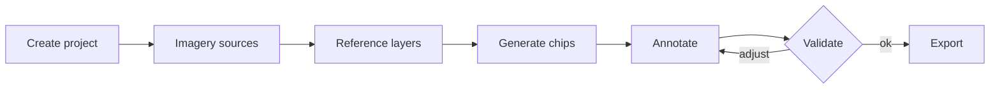

---

## Getting started

### 1. Log in for the first time

> **Who:** everyone · **Where:** home screen · **Time:** 1 minute
>
> *"I want to get into the platform and start working."*

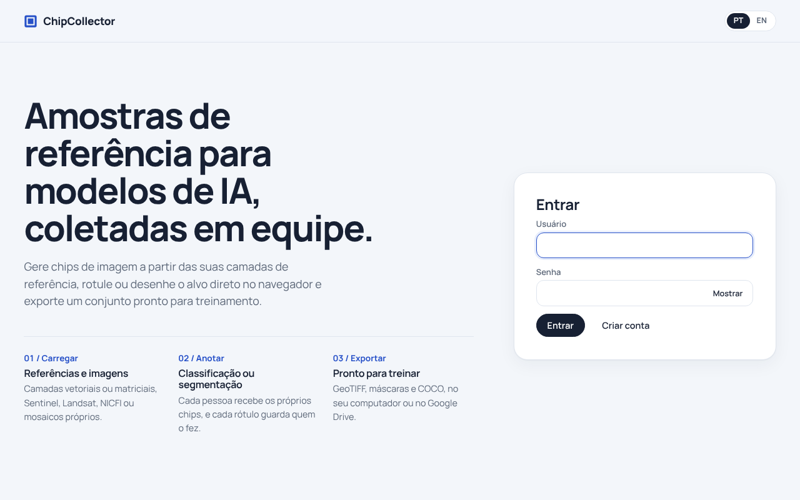

1. Open the platform's address (locally, `http://localhost:8000`).
2. If you were given a username and password, fill in both fields and press **Enter**.
3. If you don't have an account yet, click **Create account** and choose a username and a password with at least 6 characters.

**Result:** you land on the project list.

<details>
<summary>See the project list</summary>

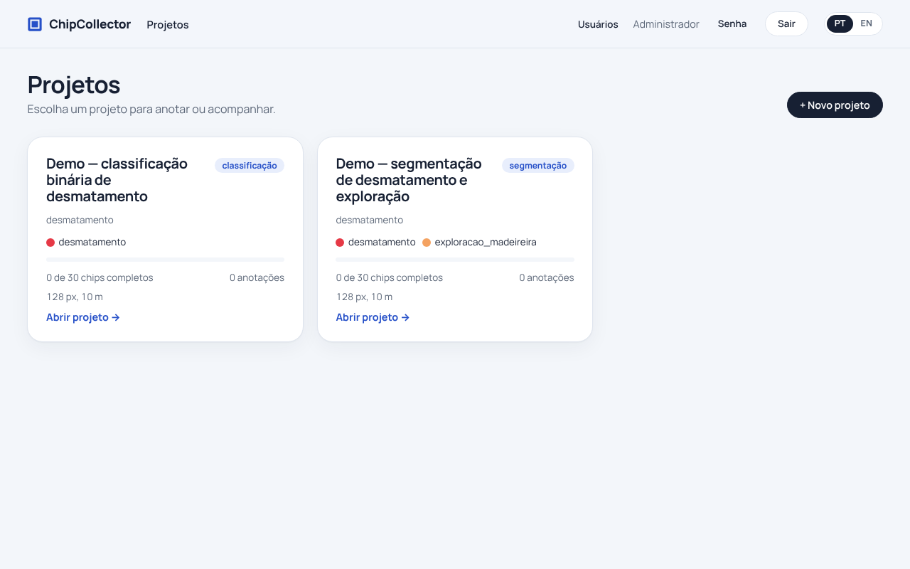

</details>

> [!NOTE]
> The **first account created** in an installation becomes the administrator. When there are no
> users yet, the screen opens directly on *Create account* and says so.

> [!TIP]
> The password is hidden while you type. Use the **Show** button inside the field to check it.
> With the demo data, log in with `admin` / `admin123`.

---

### 2. Change language and password

> **Who:** everyone · **Where:** top bar · **Time:** 30 seconds
>
> *"I want to use the platform in English" or "I want to change the password I was given."*

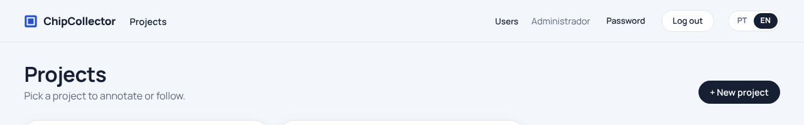

- **Language:** click **PT** or **EN** in the top right corner. The screen changes immediately and the choice is saved in your browser.
- **Password:** click **Password** in the top bar, type the new password (minimum 6 characters) and confirm.

---

## Administration

### 3. Build the team

> **Who:** administrator · **Where:** top bar → **Users** · **Time:** 1 minute per person
>
> *"I want to give access to the people who will annotate and decide who can set up projects."*

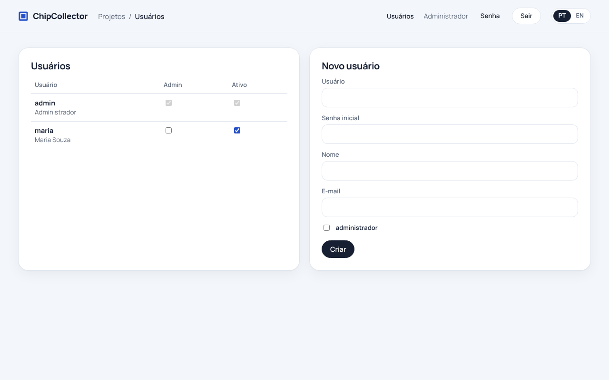

1. Click **Users** in the top bar (only visible to administrators).
2. Under **New user**, fill in username, initial password, name and email.
3. Tick **administrator** only for people who will create and set up projects.
4. Click **Create** and send the username and password to the person. Ask them to change the password on first login ([story 2](#2-change-language-and-password)).

In the list alongside you can, at any time:
- **Admin:** grant or remove the administrator role;
- **Active:** untick to block someone's access, without deleting what they have already annotated.

| What each role can do | Annotator | Administrator |
|---|:---:|:---:|
| Annotate chips, view map and progress | yes | yes |
| Create a chip with one click on the map | yes | yes |
| Export samples | yes | yes |
| Create and set up projects, upload layers, generate chips | | yes |
| See other people's annotations on the same chip | | yes |
| Manage users | | yes |

> [!TIP]
> By default, anyone can create their own account on the home screen. To let only administrators
> create accounts, start the server with `CHIPS_ALLOW_SIGNUP=false`.

> [!NOTE]
> There is no button yet for an administrator to reset another person's password. If someone
> forgets their password, deactivate the old account and create a new one.

---

## Setting up a project

### 4. Create the project

> **Who:** administrator · **Where:** Projects → **+ New project** · **Time:** 3 minutes
>
> *"I want to start collecting selective-logging samples, with polygons, in 256 × 256 pixel chips."*

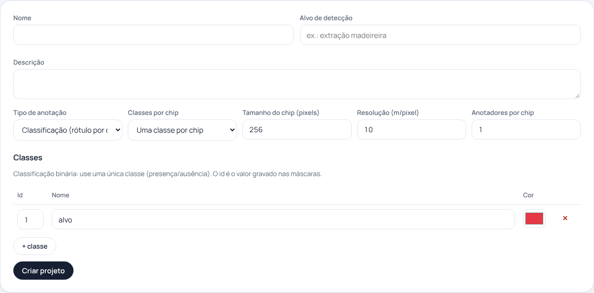

1. On the project list, click **+ New project**.
2. Fill in:

   | Field | What to decide |
   |---|---|
   | **Name** and **Detection target** | E.g. "Selective logging 2024", target "selective logging" |
   | **Annotation type** | *Classification*: one label per chip (present/absent or which class). *Segmentation*: polygons drawn inside the chip |
   | **Classes per chip** | *One class*: each chip gets at most one class. *Several*: a chip can have more than one |
   | **Chip size** and **Resolution** | E.g. 256 px × 10 m = 2.56 km per side. Use the resolution of the imagery that will be used for training |
   | **Annotators per chip** | 1 for fast collection; 2 or more to measure agreement ([story 13](#13-double-blind-annotation)) |
   | **Classes** | Name and colour of each class. The **id** is the value written to the masks (0 is always background) |

3. Click **Create project**. You go straight to the **Set up** tab.

> [!IMPORTANT]
> **Chip size** and **resolution** cannot change once chips have been generated. Decide before
> generating.

> [!TIP]
> For **binary classification** (target present or not), create a single class. Annotators will
> see the *Present* and *Absent* buttons.

<details>
<summary>See the full settings screen (Set up tab → 01)</summary>

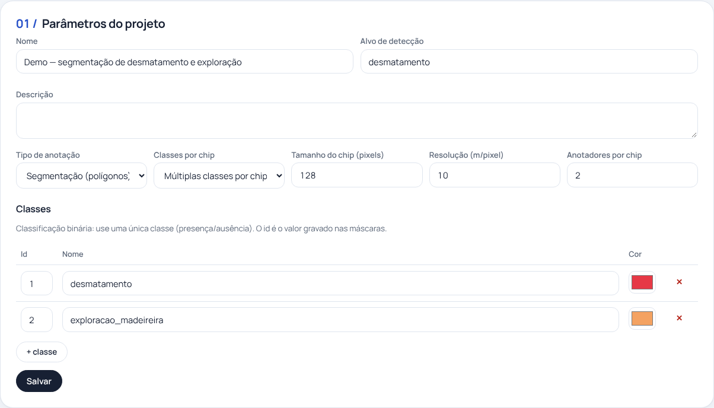

</details>

---

### 5. Choose the imagery sources

> **Who:** administrator · **Where:** Set up → **02 / Imagery** · **Time:** 5 minutes
>
> *"I want annotators to see the target at the right time of year: Sentinel-2 in the dry season and Planet NICFI for more detail."*

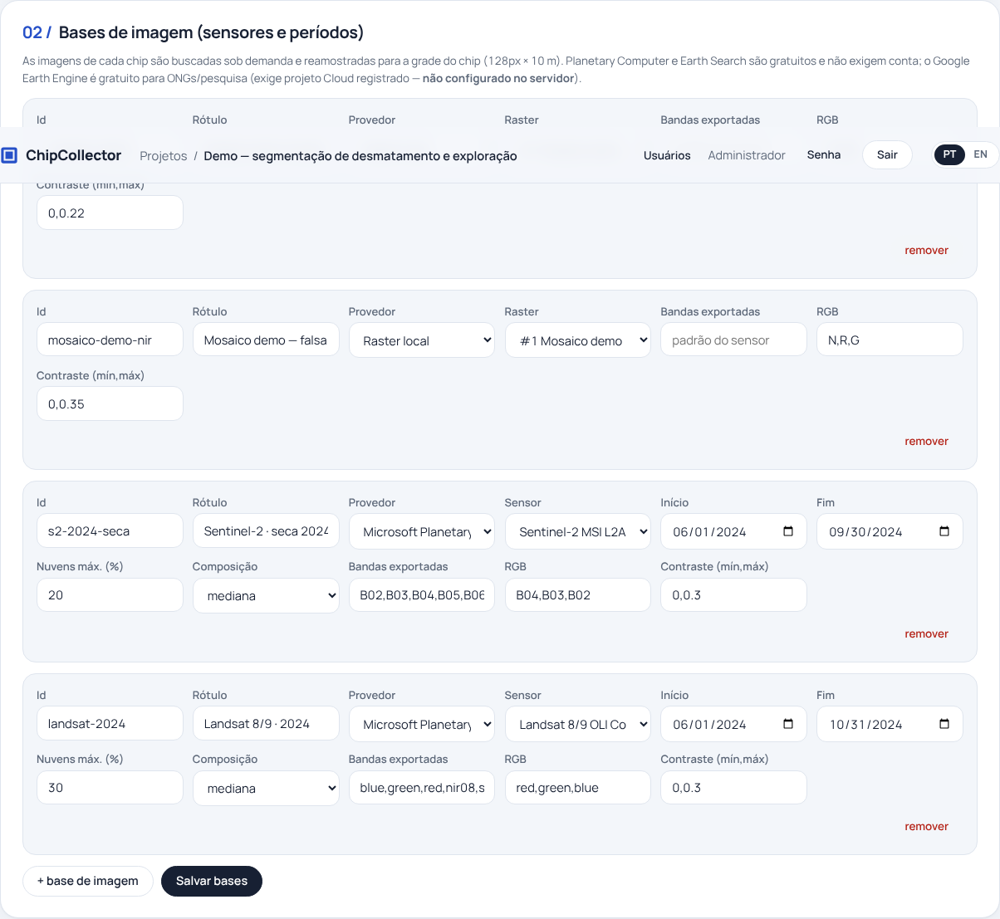

1. Click **+ imagery source**. Each source is a combination of **provider + sensor + period**.
2. Fill in:
   - **Id** and **Label:** how the source appears to annotators (e.g. `s2-2024-dry`, "Sentinel-2 · dry season 2024");
   - **Provider** and **Sensor:** see the table below;
   - **Start** and **End:** the period of the scenes;
   - **Max. clouds:** discards scenes cloudier than this;
   - **Composite:** *median* (blends all scenes, removes clouds better) or *least cloudy scene* (a single date, sharper);
   - **RGB** and **Stretch:** how the image is displayed on screen (leave blank to use the default).
3. Repeat for as many sources as you want and click **Save imagery**.

| Provider | Sensors | Account needed? |
|---|---|---|
| Microsoft Planetary Computer | Sentinel-2, Landsat 8/9, Landsat 5/7, Sentinel-1 | No |
| Earth Search (AWS) | Sentinel-2 | No |
| Google Earth Engine | Sentinel-2, Landsat, Sentinel-1, **Planet NICFI**, any collection | Yes, free for NGOs and research (configured on the server) |
| Local raster | Any GeoTIFF you upload | No |

> [!TIP]
> Create **two sources of the same target at different times** (e.g. dry and wet season, or
> before and after). While annotating, the annotator switches between them with the **B** key or
> overlays one on the other with *Compare with*.

> [!NOTE]
> To use your own mosaic (drone, CBERS, downloaded NICFI), first upload the file under
> **Local rasters** ([story 6](#6-upload-and-set-up-the-layers)) and then create a source with
> the **Local raster** provider.

---

### 6. Upload and set up the layers

> **Who:** administrator · **Where:** Set up → **03 / Reference layers and samples** · **Time:** 3 minutes
>
> *"The statistics team already did the sampling design and sent me the points and polygons with
> the stratum of each sample. I want each one to become a chip."* or *"I have the PRODES polygons
> and want the system to draw the chips."*

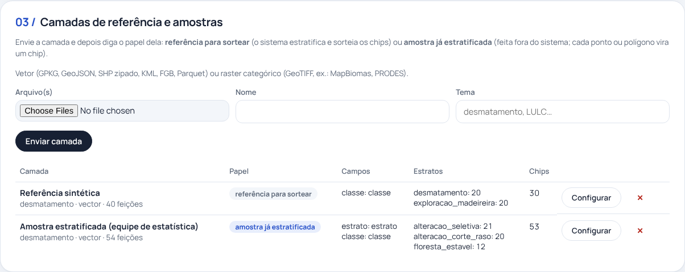

Every layer has a **role**, and you decide which:

| Role | When to use | What the system does |
|---|---|---|
| **Pre-stratified sample** | The sampling design was done outside the system | Each point or polygon becomes **one chip**, centred on it. Nothing is drawn at random |
| **Reference to sample from** | You have reference features and want the system to pick the samples | Stratifies by class and **randomly draws** chips inside the features ([story 7](#7-generate-the-chips)) |

**Upload**

1. Under **File(s)**, choose the file:
   - **vector:** GeoPackage, GeoJSON, KML, FlatGeobuf, GeoParquet or Shapefile (the `.zip`, or the `.shp`, `.dbf`, `.shx`, `.prj` files together);
   - **categorical raster:** GeoTIFF with one integer per class (e.g. MapBiomas). A raster is always a *reference to sample from*.
2. Give it a **Name** and a **Theme** and click **Upload layer**.

**Set up** (opens automatically after upload, or via the **Set up** button on the layer's row)

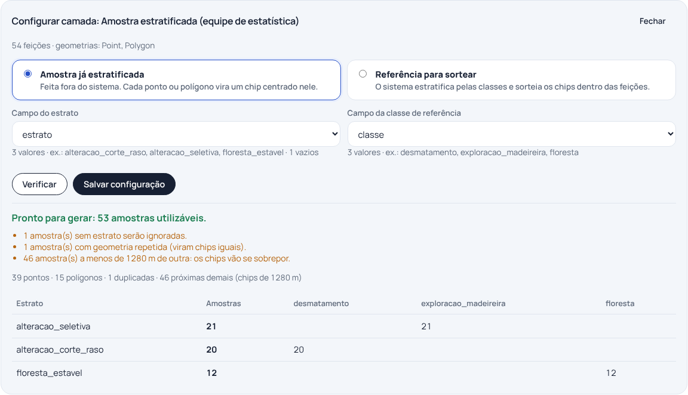

3. Choose the **role**. The system makes a suggestion when the file has a field that looks like
   "stratum" or contains only points, but the decision is yours.
4. Choose the **fields** from the lists. Example values appear below each one so you can check:
   - *Pre-stratified sample:* **Stratum field** (required, the stratum from the sampling design) and **Reference class field** (optional, the class the team assigned to each sample);
   - *Reference to sample from:* **Class field**, which defines the sampling strata.
5. Click **Check** and read the report. Then click **Save settings**.

What the check looks for:

| Result | What it means | What to do |
|---|---|---|
| Error: field does not exist | The chosen field is not in the file | Choose another field |
| Error: features that are neither points nor polygons | The file has lines or other geometries | Remove them from the file and upload again |
| Warning: samples without a stratum | Rows with an empty stratum field | They will be ignored. Fix the file if that was not intended |
| Warning: looks like an identifier | The field has almost one distinct value per sample | You probably picked the `id`; choose the stratum field |
| Warning: repeated geometry | Two samples in the same place | They become two identical chips. Check with whoever made the sample |
| Warning: too close | Samples closer to each other than the chip size | The chips will overlap. Common in dense samples; decide whether that is acceptable |
| Warning: polygons larger than the chip | The polygon does not fit in the chip | The chip is centred on the polygon and shows only part of it |

The report table shows how many samples there are in each stratum and, if there is a class field,
the **stratum × reference class** cross-tabulation. Check that it matches the sampling design.

> [!NOTE]
> Errors block saving. Warnings do not: the system shows them, and you decide.

> [!TIP]
> If stratum and class are the same thing in your file, pick the same field for both.

In the **Local rasters** panel, just below, you upload your own mosaics to use as imagery sources.

---

### 7. Generate the chips

> **Who:** administrator · **Where:** Set up → **04 / Generate chips** · **Time:** 1 minute
>
> *"I want to turn the sample into chips so the team can start annotating."*

Choose the **Layer**. The screen changes depending on its role.

**If the layer is a pre-stratified sample**

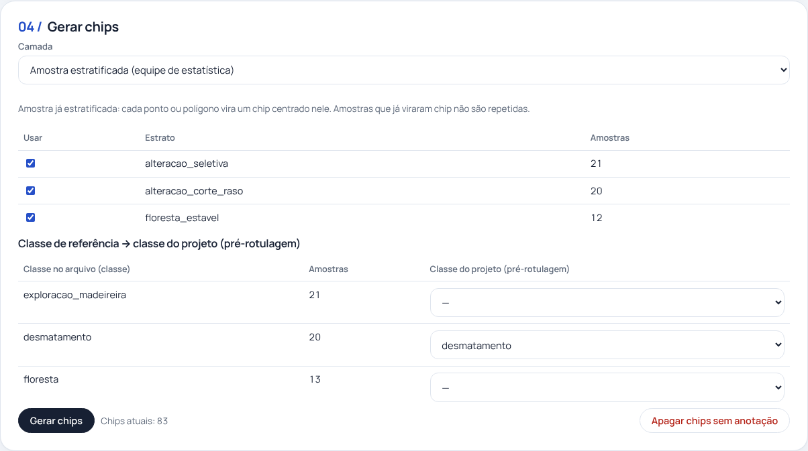

1. Tick the strata to include (all by default).
2. If the layer has a reference class, map each class in the file to a project class under
   **Project class (pre-labelling)**. Classes with no match stay blank.
3. Click **Generate chips**. Each sample becomes a chip.

You can safely click **Generate chips** again: samples that already have a chip **are not repeated**.
This lets you generate one stratum now and another later.

**If the layer is a reference to sample from**

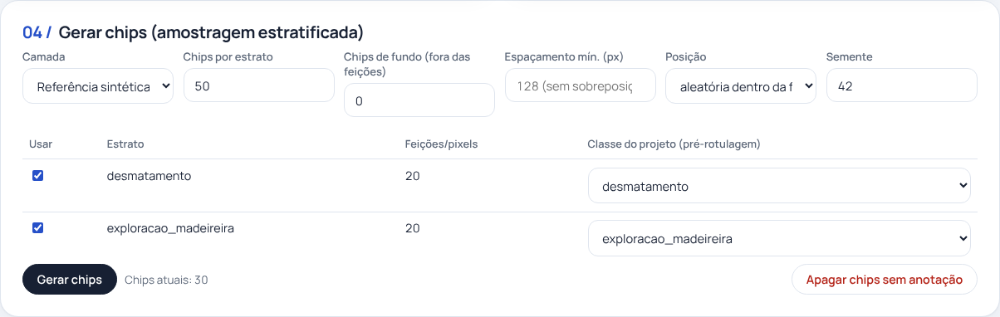

1. Set:

   | Field | What it is for |
   |---|---|
   | **Chips per stratum** | How many chips to draw inside each class of the layer |
   | **Background chips** | Chips **outside** all features: negative examples for the model |
   | **Min. spacing** | Minimum distance between centres, in pixels. Empty = chip size (no overlap) |
   | **Placement** | *Random inside the feature* (variety) or *feature centre* (one chip per feature) |
   | **Seed** | The same number produces the same draw |

2. In the strata table, tick which ones to use and map each stratum to a project class.
3. Click **Generate chips**. Generating again **adds** a new draw.

**Result, in both cases:** the chips enter the annotation queue, mixed across strata.

> [!TIP]
> **Pre-labelling** makes the reference appear dashed, in the class colour, on the annotation
> screen. In segmentation projects, the annotator can copy those polygons and just adjust the
> vertices ([story 11](#11-draw-the-target-segmentation)).

> [!NOTE]
> To start over, use **Delete unannotated chips**. Chips that already have annotations are never
> deleted by this button. For a ready-made sample, the deleted samples can become chips again.

---

### 8. Create a chip with one click

> **Who:** everyone · **Where:** **Map** tab · **Time:** seconds
>
> *"I spotted a logging area the random draw missed and I want to add it as a sample."*

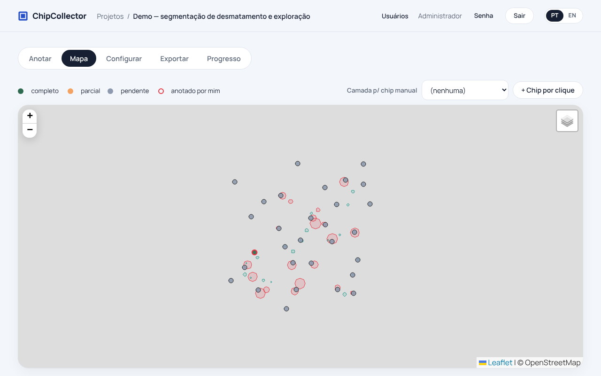

1. Open the **Map** tab. Each dot is a chip: green = complete, orange = partial, grey = pending, red outline = annotated by you.
2. (Optional) Under **Layer for manual chips**, choose a layer to bring its reference into the new chip.
3. Click **+ Chip by click** and then on the exact spot on the map.

**Result:** the chip is created with stratum `__manual__` and opens straight in the annotation screen.

> [!TIP]
> Clicking any dot on the map opens that chip, which is handy for reviewing a specific region.
> Use the layers button in the corner of the map to switch the background to the cloud-free
> Sentinel-2 mosaic.

---

## Collecting data

### 9. Work through the chip queue

> **Who:** annotator · **Where:** **Annotate** tab · **Time:** throughout the work
>
> *"I want to get one chip at a time without bumping into my colleagues' work."*

When you open **Annotate**, the platform hands you the next free chip. It is **reserved** for you
for 20 minutes, so nobody else picks up the same chip at the same time.

In the right-hand panel:
- **Stratum filter** (next to "Chip #"): work on one class at a time, if you prefer;
- **Imagery:** switch sensor or period (**B** key);
- **R, G, B, Min., Max.:** set the band composite and stretch. E.g. NIR in the red channel highlights vegetation;
- **Compare with:** overlays another source, with a transparency slider;
- **GeoTIFF:** downloads the chip image with all bands;
- **Minimap:** shows where the chip is in the world;
- **My latest:** lists what you annotated recently.

Every annotation ends with one of these three buttons:

| Button | Key | When to use |
|---|:---:|---|
| **Save** | `Enter` | You are sure of the label |
| **Unsure** | `U` | You labelled it but have doubts; the reviewer can filter these later |
| **Skip** | `S` | It can't be interpreted (clouds, bad image). Not included in the export |

> [!NOTE]
> **Skip** counts as your turn on that chip: it won't come back to you. If the project has one
> annotator per chip, a skipped chip leaves everyone's queue.

---

### 10. Label chips (classification)

> **Who:** annotator · **Where:** Annotate, in a classification project · **Time:** a few seconds per chip
>
> *"I want to say, chip by chip, whether there is deforestation or not, as fast as possible."*

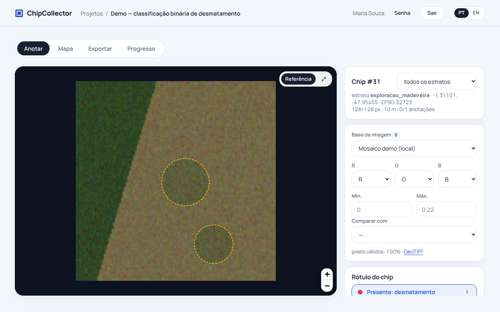

<details>
<summary>See a chip that came from a pre-stratified sample</summary>

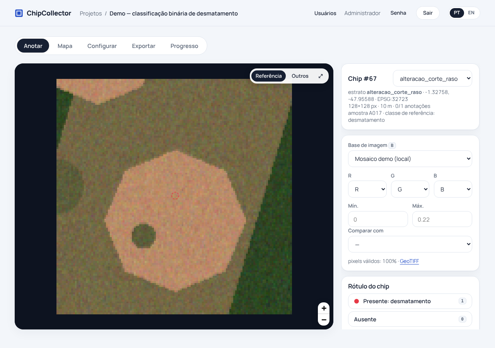

</details>

1. Look at the image. The reference appears dashed (the **R** key shows or hides it).
   For chips that came from a ready-made sample, the panel shows the sample identifier and its
   reference class, and the sample point appears as a ring at the centre of the chip.
2. Pick the label:
   - single class: **1** = Present, **0** = Absent;
   - several classes: **1**, **2**, **3**… for each class; **0** = none. If the project allows several classes per chip, each key toggles that class on or off.
3. Press **Enter**. The next chip opens automatically.

> [!TIP]
> With your left hand on the keyboard (numbers, **Enter**, **U**, **S**, **B**), you can label
> hundreds of chips per hour without touching the mouse.

---

### 11. Draw the target (segmentation)

> **Who:** annotator · **Where:** Annotate, in a segmentation project · **Time:** 1 to 3 minutes per chip
>
> *"I want to outline exactly the logging clearings inside each chip."*

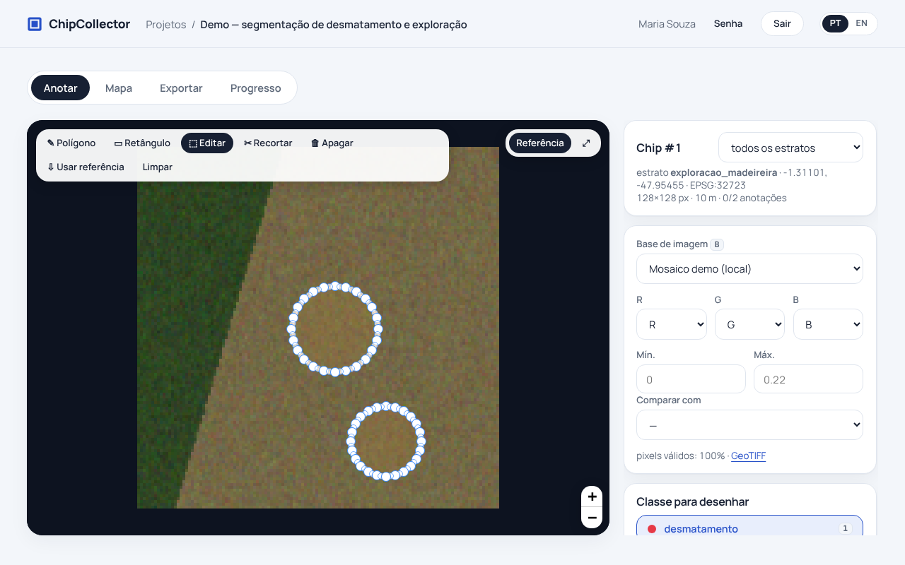

1. Choose the **class** in the panel (or keys **1**, **2**…).
2. Draw:
   - **Polygon** (**P** key): click each vertex and click the first point to close it;
   - **Rectangle:** click one corner and then the opposite corner;
   - to speed things up, use **Use reference**, which copies the polygons from the reference layer with their class. Then just adjust.
3. Adjust:
   - **Edit** (**E** key): drag the vertices;
   - **Cut:** draw over a polygon to remove a piece (e.g. an island of forest);
   - **Delete** (**Del** key): then click the polygon you want to remove;
   - click a polygon to change it to the selected class.
4. Press **Esc** to exit the tool and **Enter** to save.

> [!NOTE]
> **No polygons = target absent.** Saving an empty chip is a valid answer, and an important one
> for the model to learn what is not the target.

> [!TIP]
> Anything that crosses the chip border is clipped automatically on save. No need to be careful
> around the edge.

---

### 12. Fix an annotation

> **Who:** annotator · **Where:** Annotate → **My latest** · **Time:** seconds
>
> *"I saved a chip wrong and want to fix it."*

1. Under **My latest**, click the chip number (e.g. `#12`).
2. The chip opens with your annotation, marked as *already annotated by you*.
3. Fix it and save again. The previous annotation is **replaced**; a second one is not created.

---

## Validating data

### 13. Double, blind annotation

> **Who:** administrator · **Where:** Set up → **Annotators per chip** · **Time:** 1 minute
>
> *"I want to know whether the labels are reliable before training the model."*

1. In **Set up → 01 / Project settings**, set **Annotators per chip = 2** (or more) and save.
2. The queue now prioritises chips that **someone has already started**, so pairs are closed quickly.
3. Each annotator works **blind**: they can't see what their colleague marked on the same chip.
4. A chip is **complete** once it reaches the set number of annotations.

**Result:** in the export, each chip has one row (and one mask) per annotator. With that you can
compute agreement between them (kappa, IoU) and decide what to do with the chips they disagree on.

> [!TIP]
> A common strategy: double annotation on 10 to 20% of chips to measure the team's quality, and
> single annotation on the rest.

---

### 14. Review someone else's work

> **Who:** administrator · **Where:** Annotate → **Others** button · **Time:** seconds per chip
>
> *"I want to see how Maria outlined this clearing and compare it with my own reading."*

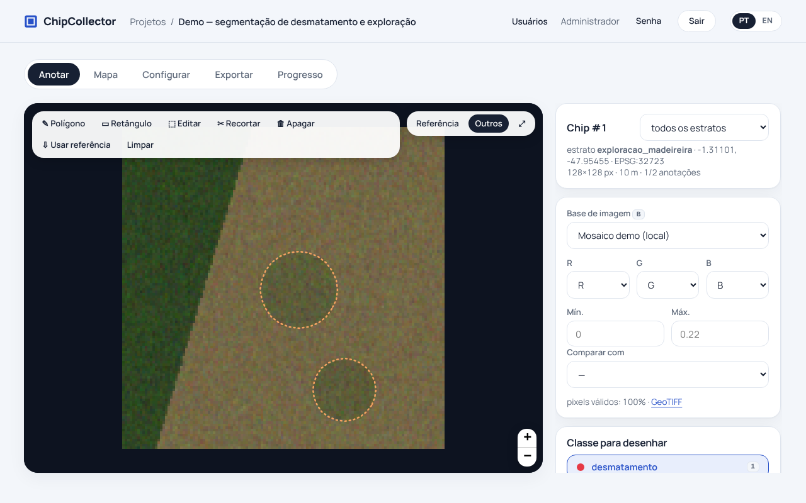

1. Open the chip: from the **Map** (click the dot), from the queue, or via the address `#/p/<project>/annotate/<chip>`.
2. Click **Others**. Other people's annotations appear dotted, in each class's colour.
3. Hide the **Reference** if it gets in the way of the comparison.
4. If you agree, make your own annotation and save. It counts as the second opinion on that chip.

What helps with validation:
- for **pre-stratified sample** chips, the export includes the **reference class** (`ref_class`) next to each annotator's label. This lets you measure agreement between the annotation team and the reference;
- the **Unsure** status flags chips the annotator had doubts about;
- the export includes the author of each annotation, so you can review per person;
- each annotation's **Comment** appears in `labels.csv`.

> [!NOTE]
> There is no *approve* or *reject* button for another person's annotation yet. Today, validation
> is done through double annotation, visual review with **Others** and the status filters on export.

---

### 15. Track progress

> **Who:** everyone · **Where:** **Progress** tab · **Time:** a glance
>
> *"I want to know how much is left and who is annotating what."*

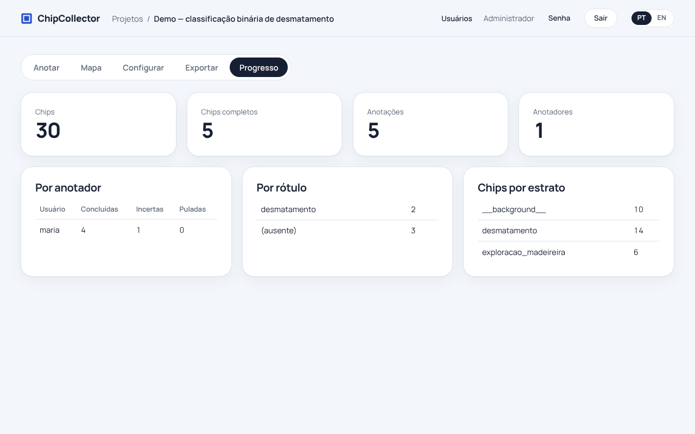

- **Chips, Complete chips, Annotations, Annotators:** the size of the job and how much is done;
- **By annotator:** done, unsure and skipped for each person. Many skips may point to an imagery source that is poor for the target;
- **By label:** whether the classes are balanced;
- **Chips per stratum:** how many chips each reference class generated.

> [!TIP]
> If a class ends up with few examples, go back to [story 7](#7-generate-the-chips) and generate
> more chips for that stratum only.

---

## Exporting

### 16. Build the training package

> **Who:** everyone · **Where:** **Export** tab · **Time:** seconds to minutes, depending on volume
>
> *"I want to download the samples ready to train a model in PyTorch."*

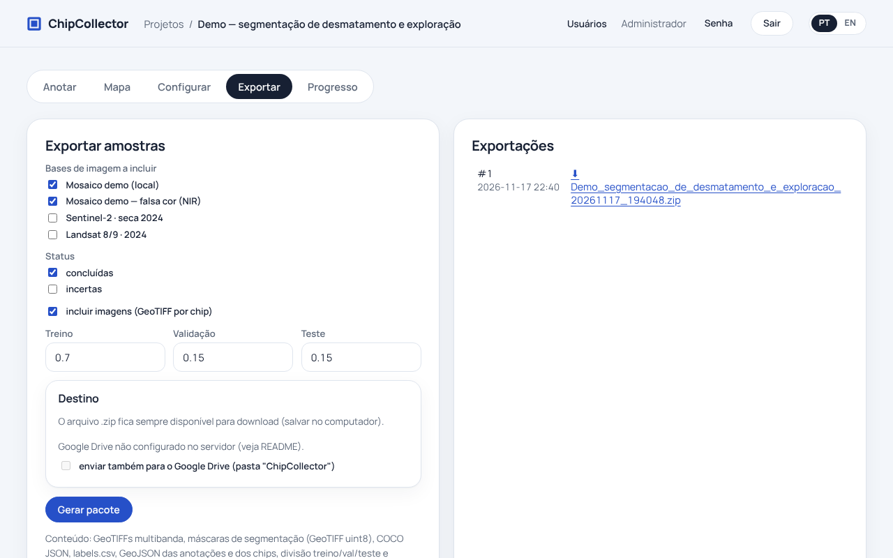

1. Tick the **imagery sources** to include in the package. Each becomes a folder of GeoTIFFs.
2. Under **Status**, choose *done* and, optionally, *unsure*. Skipped chips are never included.
3. Adjust the **Train / Validation / Test** split (default 70 / 15 / 15). The split is done **per chip**: all annotations of the same chip always fall in the same group.
4. Click **Build package**. Progress appears under **Exports**; when it finishes, click the file name to download the `.zip`.

What's in the package:

| File | What it is for |
|---|---|
| `images/<source>/chip_000123.tif` | Georeferenced multiband image of each chip |
| `masks/chip_000123__<user>.tif` | Segmentation mask (0 = background, n = class id) |
| `coco/<source>.json` | Annotations in COCO format (Detectron2, MMDetection) |
| `labels.csv` | One row per annotation: chip, author, status, labels, split, file paths. For ready-made samples, also `stratum`, `sample_index` (position of the feature in the uploaded file) and `ref_class` |
| `annotations.geojson`, `chips.geojson` | Polygons and chip outlines, to open in QGIS |
| `metadata.json` | Project settings, classes, sources and counts |

> [!TIP]
> You can also export from the terminal, useful for automated routines:
> `chipcollector export 1 --out ./exports --status done uncertain`

---

### 17. Send to Google Drive

> **Who:** everyone · **Where:** Export → **Destination** · **Time:** 1 minute the first time
>
> *"I want the package to go straight to the team's folder on Drive."*

1. Under **Destination**, click **Connect my Google Drive** and authorise access.
2. Tick **also upload to Google Drive** and build the package.
3. When it finishes, the **open in Drive** link appears next to the file, in the `ChipCollector` folder.

> [!NOTE]
> The button only appears if the server is configured for Drive (see *Setting up Google Drive* in
> the [README](../README.md#setting-up-google-drive)). The platform only sees the files it creates
> itself in your Drive.

---

## Publishing for testing

### 18. Publish a test version

> **Who:** whoever runs the platform · **Where:** your computer's terminal · **Time:** 5 minutes the first time
>
> *"I want the team to test it over the internet, without paying for a server or hosting."*

The platform runs on your computer and Cloudflare creates a public HTTPS address pointing to it.
No account, domain or card needed.

1. Install `cloudflared` once:

   | System | Command |
   |---|---|
   | macOS | `brew install cloudflared` |
   | Windows | `winget install --id Cloudflare.cloudflared` |
   | Linux | package at developers.cloudflare.com (*Cloudflare Tunnel → Downloads*) |

2. If you used the demo data, change the `admin` password:
   ```bash
   chipcollector set-password admin
   ```
   The publish command refuses to open the tunnel while any account still has the password `admin123`.

3. Publish:
   ```bash
   chipcollector share
   ```
   In a few seconds a box appears with the **public address** (`https://….trycloudflare.com`).

4. Create the team's accounts under **Users** ([story 3](#3-build-the-team)) and send the address
   along with each person's username and password.

5. To stop, press **Ctrl+C** in the terminal. The address stops working immediately.

> [!IMPORTANT]
> The address is **different every time** you run `chipcollector share`, and only works while the
> computer is on, awake and the command is running. For a fixed address you need a Cloudflare
> account with a named tunnel, or your own server.

> [!NOTE]
> While the tunnel is open, **public sign-up is turned off**: only the administrator creates
> accounts. To allow it, run `CHIPS_ALLOW_SIGNUP=true chipcollector share`.

> [!TIP]
> Files over **100 MB** (large mosaics) don't pass through the tunnel. Since the platform runs on
> your computer, upload those files via the local address, `http://localhost:8000`. They become
> available to everyone immediately.

What doesn't work on the temporary address:
- **connecting Google Drive:** Google requires a fixed redirect address registered in advance. Downloading the `.zip` works normally;
- **many simultaneous users:** the free tunnel accepts up to 200 concurrent requests, which is enough for a test team.

## Common problems

<details>
<summary><b>I can't type in the login form</b></summary>

This was a bug in early versions. Update (`git pull`), restart the server and reload the page
with **Ctrl+Shift+R** (on Mac, **Cmd+Shift+R**).
</details>

<details>
<summary><b>The chip image doesn't load, or "No scenes found" appears</b></summary>

- Widen the source's period or raise the cloud limit (**Set up → 02**).
- Planetary Computer and Earth Search need internet access on the **server**, not just in your browser.
- For Google Earth Engine, the server must be authenticated (see the README).
- The first read of each chip can take a few seconds. After that the image is cached.
</details>

<details>
<summary><b>I want to change the chip size after generating</b></summary>

That's not possible within the same project, because existing annotations would become
misaligned. Create a new project with the right size.
</details>

<details>
<summary><b>The chip I wanted disappeared from the queue</b></summary>

It may be reserved for someone else (for up to 20 minutes), already have the required number of
annotations, or have been skipped by you. To open a specific chip, click it on the **Map** tab.
</details>

<details>
<summary><b>"Internal error (…). See the server log." appeared</b></summary>

Copy the message and the last lines from the terminal where `chipcollector serve` is running and
open an issue in the repository.
</details>

<details>
<summary><b>How do I back up?</b></summary>

Copy the whole data folder (`data/` by default) with the server stopped. It holds the database,
layers, rasters and exports.
</details>
